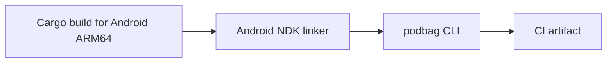

# Contributing to podbag

Thank you for helping. Bug reports, fixes and new features are all welcome.

## Contents

- [Issue format](#issue-format)
- [Report a problem](#report-a-problem)
- [Build](#build)
- [Test](#test)
- [Pull requests](#pull-requests)
- [Release](#release)
- [Translations](#translations)
- [Website](#website)
- [License](#license)

## Issue format

Write every issue in English. Use these headings in order, with one short bullet under each.

- `## Summary` describes the problem or requested change.
- `## Architecture` names the components involved and how they interact.
- `## Implementation` describes the proposed change or the steps to reproduce a bug.
- `## Note` records a constraint, test result, or other relevant detail.

Every issue must include a fenced `mermaid` diagram directly after the Architecture bullet.
For example, an Android build issue can show how the CLI reaches the CI artifact.



## Report a problem

Open an issue. Include:

- the command you ran,
- what you expected, and what happened,
- the output of `podbag --version` and `podbag check`.

## Build

```sh
cargo build    # the program and the library
```

- Build instructions for Linux, Android, macOS and Windows: [docs/build.md](docs/build.md).

## Test

### On any system

```sh
cargo test     # unit tests; tests that need Linux are skipped elsewhere
```

### Linux tests from a Mac

podbag uses Linux kernel features, so most tests run on Linux. On a Mac,
[lima](https://lima-vm.io) runs them in a VM:

```sh
dev/vm.sh up           # create and set up the podbag-dev VM (once)
dev/vm.sh test         # cargo test in the VM, without root
dev/vm.sh test-root    # cargo test in the VM, as root
dev/vm.sh static       # the static release binary, and a check of its size
```

### More tests

- `PODBAG_TEST_NETWORK=1` adds the tests that pull images or use the network.
- `PODBAG_TEST_MACOS_VM=1 cargo test --test macos_vm` tests the macOS VM.

### End-to-end tests

They pull real images from `mirror.gcr.io`, and compare podbag with Docker (or Podman,
when no Docker daemon runs):

```sh
tests/e2e/run.sh                     # .pyc files, cron, a damaged file in the store
tests/e2e/nginx.sh                   # nginx with podbag, and with the docker CLI on its API
PODBAG_E2E_ROOT=1 tests/e2e/run.sh   # as root
PODBAG=./target/debug/podbag tests/e2e/nginx.sh   # another podbag binary
```

In the VM: `dev/vm.sh run bash -c 'cargo build && PODBAG=$CARGO_TARGET_DIR/debug/podbag tests/e2e/run.sh'`.

### Desktop browser tests

Run `node desktop/preview/test.mjs` with Node.js 22 or later and Chrome. It runs every
`*.test.html` in `desktop/preview` against the real UI with a mocked engine API. Update
or add the applicable browser test when changing a Desktop workflow. CI runs this suite
on pull requests and on `main`.

## Pull requests

- One change per pull request, with tests for new behavior.
- Run `cargo fmt`.
- Leave no compiler warnings.
- `cargo test` must pass. CI checks Linux, macOS and Windows. On Linux it also runs the
  store's integration tests, the end-to-end tests and nginx, without root and as root.
- Commit messages are one line: `type: what changed`. Types: `feat`, `fix`, `docs`,
  `test`, `refactor`, `chore`.

## Release

- Open a pull request that sets the new version and adds its changelog section:
  - the version in `Cargo.toml`, `desktop/Cargo.toml`, `desktop/tauri.conf.json` and
    `Cargo.lock`;
  - a `## vX.Y.Z (date)` section in `CHANGELOG.md`.
- After the merge, tag the merge commit and push the tag:

  ```sh
  git fetch origin
  git tag vX.Y.Z origin/main
  git push origin vX.Y.Z
  ```

- The **Release** workflow then does the rest:
  - It checks that the tag is on `main`, that every version matches the tag, and that
    the changelog has a section for it.
  - It runs CI and builds the Linux packages on the tag.
  - It publishes the GitHub release with every file, `SHA256SUMS`, and the changelog
    section as the notes.
  - It starts **Publish to crates.io**.
- If a job fails by chance (a flaky test, a lost runner), re-run the failed jobs. A draft
  release that a failed try left is replaced.
- For a dry run, run **Release** by hand from `main`. It makes and checks every file of
  the current version and keeps them as the `release-files` artifact. It publishes
  nothing.

### crates.io

- A stable release publishes the `podbag` CLI and library to crates.io.
- The workflow checks out the release tag and requires its Cargo version to match.
- The `crates-io` environment uses
  [Trusted Publishing](https://crates.io/docs/trusted-publishing).
- To publish an existing stable release, run **Publish to crates.io** from `main` in
  GitHub Actions and enter the release tag.

## Translations

- `README.md` is the source. `README.<language>.md` files follow it.
- When you change `README.md`, say so in the pull request, so that the translations can
  follow.
- The website's words are in the [podbag-page](https://github.com/SteelCrab/podbag-page)
  repository, in `site/i18n/<language>.json`.
- The words in the layers-and-files picture are in `dev/docs/storage.py` (`TEXT`).

## Website

- The website lives in its own repository:
  [SteelCrab/podbag-page](https://github.com/SteelCrab/podbag-page).
- When it builds, it takes these from this repository:
  - the pictures (`docs/images`) and the videos (`docs/media`),
  - `install.sh`, which https://podbag.dev/install.sh serves,
  - the version (`Cargo.toml`) and the picture texts (`dev/docs/storage.py`).
- A change to those files reaches the site at its next deploy: once a day, or by hand.
- The pictures come from the scripts in `dev/docs/` and from `dev/bench/charts.py`. Run the
  script again after you change one.
- The old address https://steelcrab.github.io/podbag/ sends visitors to podbag.dev
  (`dev/pages/`, `.github/workflows/pages.yml`).

## License

By contributing, you agree that your work is licensed under the Apache License 2.0.
