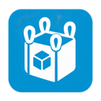

# podbag



Un motor de contenedores sin daemon, en un solo binario estático.
Guarda las imágenes archivo por archivo: un archivo que comparten muchas imágenes se guarda una sola vez.
Puedes usar la línea de comandos o [Podbag Desktop](#podbag-desktop).

[](https://github.com/SteelCrab/podbag/actions/workflows/ci.yml)
[](https://github.com/SteelCrab/podbag/releases/latest)
[](https://crates.io/crates/podbag)
[](LICENSE)
[](https://podbag.dev)

[English](README.md) · [한국어](README.ko.md) · [日本語](README.ja.md) · [简体中文](README.zh-CN.md) · [Filipino](README.fil.md) · **Español** · [Tiếng Việt](README.vi.md)


<sub>La misma introducción en vídeo (en inglés): [intro.mp4](docs/media/intro.mp4).</sub>

## Contenido

- [Características](#características)
- [Podbag Desktop](#podbag-desktop)
- [Instalación](#instalación)
- [Uso](#uso)
- [Rendimiento](#rendimiento)
- [Comparación con otras herramientas](#comparación-con-otras-herramientas)
- [Documentación](#documentación)
- [Contribuir](#contribuir)
- [Licencia](#licencia)

## Características

- **Archivos compartidos entre imágenes.** Los archivos idénticos pueden compartir espacio en disco y caché de páginas de Linux aunque pertenezcan a capas distintas.
- **Motor Linux bajo demanda.** Un solo proceso supervisa los contenedores de cada usuario. Cuando se detiene el último, el proceso termina tras un periodo de inactividad.
- **Apagado automático de la máquina virtual en macOS.** Por defecto, la máquina virtual Linux se apaga tras 60 segundos de inactividad. El siguiente comando de contenedores vuelve a iniciarla.
- **Motor para nodos de Kubernetes (`v0.2.0`).** En Linux, `podbag cri serve` permite que el kubelet ejecute pods directamente con Podbag.
- **Migración entre motores (`v0.2.0`).** Copia imágenes, volúmenes y contenedores detenidos entre motores compatibles con Docker. Los originales se conservan.

<picture><source media="(max-width: 600px) and (prefers-color-scheme: dark)" srcset="docs/images/storage-es-tall-dark.svg"><source media="(max-width: 600px)" srcset="docs/images/storage-es-tall-light.svg"><source media="(prefers-color-scheme: dark)" srcset="docs/images/storage-es-dark.svg"></picture>

## Podbag Desktop

Gestiona contenedores, imágenes, volúmenes y redes en Linux y macOS. La compatibilidad con Windows es experimental y requiere WSL 2. Desde la lista puedes iniciar, detener o reiniciar un contenedor. Ábrelo para ver sus registros en tiempo real.


[Instala Podbag Desktop](#instalación) o [compila la aplicación de escritorio desde el código fuente](docs/usage.md#build-the-desktop-app).

## Instalación

### Podbag Desktop (recomendado)

Descarga el paquete para tu sistema desde la [última versión](https://github.com/SteelCrab/podbag/releases/latest).

- **Linux (x86_64, arm64).** Instala el `.deb` en Debian o Ubuntu, o el `.rpm` en Fedora. El paquete incluye el motor.
- **macOS (Apple silicon, Intel).** Abre `podbag-desktop-aarch64-macos.dmg` (Apple silicon) o `podbag-desktop-x86_64-macos.dmg` (Intel). Arrastra `podbag` a la carpeta Aplicaciones y ábrela desde allí. La primera vez, debes permitirla una vez: [Abrirla por primera vez en macOS](#abrirla-por-primera-vez-en-macos).
- **Windows (x86_64, ARM64, experimental).** Ejecuta el `.msi` para tu CPU. Si la versión no incluye un MSI, descárgalo desde una [ejecución de CI correcta](https://github.com/SteelCrab/podbag/actions/workflows/ci.yml?query=branch%3Amain). Activa WSL 2 para ejecutar contenedores.

La app incluye la CLI. Si la terminal no tiene `podbag`, la app ofrece instalar el comando `podbag`. El comando usa la CLI de la app, así que se actualiza con la app.

### Abrirla por primera vez en macOS

Apple no ha notarizado podbag. Por eso macOS bloquea la app o la CLI descargadas con un navegador hasta que las permites una vez.

1. Abre `podbag` desde la carpeta Aplicaciones. macOS dice que no puede comprobar si podbag contiene software malicioso. Cierra el aviso.
2. Abre **Ajustes del Sistema > Privacidad y seguridad**. Junto al mensaje sobre `podbag`, haz clic en **Abrir igualmente** y confirma con tu contraseña.

Para evitar estos pasos, instala desde la terminal. Los archivos que descarga `curl` no se bloquean.

```sh
curl -fsSL https://podbag.dev/install.sh | PODBAG_DESKTOP=1 sh   # Podbag Desktop
curl -fsSL https://podbag.dev/install.sh | sh                    # solo la CLI
```

### CLI en Linux (x86_64, arm64) y macOS (Apple silicon, Intel)

```sh
curl -fsSL https://podbag.dev/install.sh | sh
podbag --version
```

El instalador verifica la suma SHA-256 del archivo publicado e instala la CLI en `/usr/local/bin`. Ejecuta el mismo script para actualizarla.

Linux requiere el kernel 5.12 o posterior y cgroup v2. Ejecuta `podbag check` para detectar los requisitos pendientes. Para usar redes de puente sin privilegios de root, comprueba que estén instalados `uidmap` y `passt`. [Requisitos de Linux](docs/usage.md#requirements-on-linux)

Para instalarlo manualmente, descarga el archivo para tu sistema y CPU y verifica su suma con `SHA256SUMS`. Dale permiso de ejecución con `chmod +x`. En un Mac, ejecuta también `xattr -d com.apple.quarantine`. [Descargas](https://github.com/SteelCrab/podbag/releases/latest)

### CLI en Windows (experimental)

Ejecuta `wsl --install` en PowerShell como administrador y reinicia Windows. Descarga `podbag-x86_64-windows.exe` o `podbag-aarch64-windows.exe` según tu CPU. Compara su suma SHA-256 con `SHA256SUMS` y cambia el nombre del archivo a `podbag.exe`. [Descargas](https://github.com/SteelCrab/podbag/releases/latest)

```powershell
.\podbag.exe run --rm alpine echo hello
```

### Otras opciones de instalación

- **Cargo en Linux.** Ejecuta `cargo install --locked podbag` para instalar la versión publicada de la CLI.
- **Compilación desde el código fuente.** Compila la CLI y Podbag Desktop con Rust. [Guía de compilación](docs/build.md)

## Uso

### Ejecutar un contenedor

Este comando imprime `hello` y elimina el contenedor cuando termina.

```sh
podbag run --rm alpine echo hello
```

Inicia nginx en el puerto 8080, envía una petición y consulta el registro de acceso.

```sh
podbag run -d --name web -p 8080:80 nginx:alpine
podbag ps
curl -I http://localhost:8080/
podbag logs web
podbag exec web nginx -v
podbag stop web && podbag rm web
```

### CLI de Docker y Compose

Linux sin privilegios de root y con `XDG_RUNTIME_DIR` definido

```sh
podbag system service &
podbag_socket="unix://$XDG_RUNTIME_DIR/podbag/docker.sock"
```

macOS

```sh
podbag vm start
podbag_socket="unix://$HOME/.podbag/run/docker.sock"
```

Una vez configurado el socket, ejecuta estos comandos en el directorio de un proyecto cuyo `compose.yaml` use imágenes publicadas.

```sh
docker --host "$podbag_socket" ps
docker --host "$podbag_socket" compose up -d
docker --host "$podbag_socket" compose down
```

### Copiar una imagen desde Docker (`v0.2.0`)

Inicia los dos motores. Si Docker ya tiene la imagen `alpine:latest`, puedes copiarla a Podbag con la CLI de Podbag v0.2.0 o posterior.

```sh
podbag migrate --from docker --to podbag image alpine:latest
```

[Guía de migración](docs/usage.md#migrate-between-engines-or-kubernetes-clusters) · [Referencia de comandos](docs/usage.md)

## Rendimiento


<sub>La misma comparación en vídeo (en inglés): [perf.mp4](docs/media/perf.mp4).</sub>

<table>
<tr>
<td><picture><source media="(prefers-color-scheme: dark)" srcset="docs/images/start-dark.svg"></picture></td>
<td><picture><source media="(prefers-color-scheme: dark)" srcset="docs/images/memory-dark.svg"></picture></td>
</tr>
<tr>
<td><picture><source media="(prefers-color-scheme: dark)" srcset="docs/images/disk-dark.svg"></picture></td>
<td><picture><source media="(prefers-color-scheme: dark)" srcset="docs/images/cache-dark.svg"></picture></td>
</tr>
</table>

- Medianas en una VM Linux: 4 CPU, 3,8 GiB, arm64.
- Versiones: podbag 0.1.0, Podman 5.7.0, Docker 29.1.3, Kiri 0.2.1.
- Todos los números y cómo se midieron: [docs/benchmarks.md](docs/benchmarks.md) y [docs/benchmarks-msa.md](docs/benchmarks-msa.md) (en inglés).
- Como runtime de un nodo de Kubernetes con k3s, con 30 pods: 2 procesos en 3,5 MiB, frente a los 63 de containerd (276 MiB) y los 32 de CRI-O (85 MiB): [docs/benchmarks-k8s.md](docs/benchmarks-k8s.md) (en inglés).

## Comparación con otras herramientas

| | podbag | Docker | OrbStack | Colima | Kiri |
|---|---|---|---|---|---|
| Funciona en | Linux, macOS, Windows¹ | Linux; macOS y Windows con Docker Desktop | macOS | macOS, Linux | Linux, macOS, Windows |
| En segundo plano | nada cuando termina el último contenedor (Mac: un proceso en espera de 2 MiB) | `dockerd`, `containerd`, un shim por contenedor | una VM Linux con Docker Engine | una VM de Lima con Docker o containerd | un daemon; en macOS y Windows, una VM pequeña |
| Almacenamiento de imágenes | archivos, cada uno una vez | capas | capas | capas | capas, se desempaquetan al primer uso |
| Mac: arranque con `docker run`, mediana² | 14.4 ms | 97.4 ms | 90.4 ms | 73.6 ms | 11.8 ms |
| Mac: memoria 6 minutos después del último contenedor² | 1.7 MiB | 950 MiB | 795 MiB | 1.54 GiB | 12 MiB |
| Licencia | Apache-2.0 | Apache-2.0; Docker Desktop es de pago para empresas grandes | propietaria | MIT | Apache-2.0 |

¹ Experimental. ² Medido en un Mac, con Docker Desktop para Docker: [docs/benchmarks.md](docs/benchmarks.md).

<picture><source media="(prefers-color-scheme: dark)" srcset="docs/images/architecture-dark.svg"></picture>

- Cómo encajan las piezas y en qué va aún por detrás podbag: [docs/architecture.md](docs/architecture.md) (en inglés).

## Documentación

Los documentos de abajo están en inglés.

- [Uso](docs/usage.md): comandos, volúmenes, redes, límites, API de Docker, TUI y GUI, macOS, Windows.
- [Arquitectura](docs/architecture.md): en qué se diferencia podbag de Docker.
- [Compilar desde el código fuente](docs/build.md): Linux, macOS, Windows.
- [Rendimiento](docs/benchmarks.md) y la [prueba con microservicios Spring](docs/benchmarks-msa.md).

## Contribuir

- Los issues y pull requests son bienvenidos.
- Consulta [CONTRIBUTING.md](CONTRIBUTING.md) (en inglés).

## Licencia

[Apache License 2.0](LICENSE)
