# podbag


Isang container engine na walang daemon, sa iisang static binary.
Iniimbak nito ang mga image nang file-by-file: ang file na ginagamit ng maraming image ay iniimbak nang isang beses lang.

[](https://github.com/SteelCrab/podbag/actions/workflows/ci.yml)
[](https://github.com/SteelCrab/podbag/releases/latest)
[](https://crates.io/crates/podbag)
[](LICENSE)
[](https://podbag.dev)

[English](README.md) · [한국어](README.ko.md) · [日本語](README.ja.md) · [简体中文](README.zh-CN.md) · **Filipino** · [Español](README.es.md) · [Tiếng Việt](README.vi.md)


<sub>Ang parehong intro bilang video (Ingles): [intro.mp4](docs/media/intro.mp4).</sub>

## Nilalaman

- [Mga tampok](#mga-tampok)
- [Pag-install](#pag-install)
- [Paggamit](#paggamit)
- [Mga benchmark](#mga-benchmark)
- [Paghahambing sa ibang tool](#paghahambing-sa-ibang-tool)
- [Dokumentasyon](#dokumentasyon)
- [Pag-ambag](#pag-ambag)
- [Lisensya](#lisensya)

## Mga tampok

- **Walang daemon.** Kapag walang container, walang tumatakbo.
- **Iisang static binary.** Mga 4 MB sa Linux.
- **Mga file, hindi mga layer.** Ang file na ginagamit ng maraming image ay iniimbak at kina-cache nang isang beses lang.
- **Mabilis.** Nagsisimula ang isang container sa mga 4 ms sa Linux.
- **Gumagana sa mga tool ng Docker.** Mga Docker at OCI image, ang `docker` CLI, Compose at buildx.
- **Kubernetes.** Ang `podbag cri serve` ang container runtime ng isang node, para sa kubelet o k3s.
- **May root man o wala.** Iisang programa ang gumagana sa dalawang paraan.
- **Linux, macOS at Windows.** x86_64 at arm64. Eksperimental pa ang suporta sa Windows.

### Mga layer at mga file

<picture><source media="(max-width: 600px) and (prefers-color-scheme: dark)" srcset="docs/images/storage-fil-tall-dark.svg"><source media="(max-width: 600px)" srcset="docs/images/storage-fil-tall-light.svg"><source media="(prefers-color-scheme: dark)" srcset="docs/images/storage-fil-dark.svg"></picture>

- Isang beses lang iniimbak ng mga layer store (Docker, Podman, Kiri) ang isang layer kapag pareho ang buong layer. Kapag may isang file na iba, iniimbak ulit ang buong layer, kasama ang mga file na pareho sa ibang layer.
- Iniimbak ng podbag ang bawat file nang isang beses. Ang image ay listahan ng mga path na tumuturo sa mga file.
- Para sa 8 Spring service sa 2 release: 902 MiB sa disk laban sa 2,970 MiB ng Docker, at 324 MiB na page cache laban sa 982 MiB.

## Pag-install

### Install script (Linux at macOS)

```sh
curl -fsSL https://podbag.dev/install.sh | sh
```

- Dina-download ang file para sa iyong system at sinusuri ang SHA-256 nito.
- Ini-install ito sa `/usr/local/bin`, gamit ang `sudo` kung kailangan.
- Sa Ubuntu 24.04 at mas bago, idinadagdag ang AppArmor profile na kailangan ng mga rootless container.
- Mga setting: `PODBAG_VERSION=v0.1.0`, `PODBAG_INSTALL_DIR=$HOME/.local/bin`,
  `PODBAG_SKIP_APPARMOR=1`.

### Pag-download

Kumuha ng file mula sa [pinakabagong release](https://github.com/SteelCrab/podbag/releases/latest). Suriin ito gamit ang `SHA256SUMS`.

| System | File |
|---|---|
| Linux, x86_64 | `podbag-x86_64-linux` |
| Linux, arm64 | `podbag-aarch64-linux` |
| macOS, Apple silicon | `podbag-aarch64-macos` |
| Windows, x86_64 (eksperimental) | `podbag-x86_64-windows.exe` |
| Windows, arm64 (eksperimental) | `podbag-aarch64-windows.exe` |

Kailangan ng Windows ang WSL 2 (patakbuhin nang isang beses ang `wsl --install`):

```powershell
curl.exe -fsSLo podbag.exe https://github.com/SteelCrab/podbag/releases/latest/download/podbag-x86_64-windows.exe
.\podbag.exe run --rm alpine echo hello
```

### Cargo

```sh
cargo install podbag
```

- Para sa Linux. Sa macOS at Windows, gamitin ang mga file ng release: kasama na roon ang VM at ang Linux engine.

### Pag-build mula sa source

- Tingnan ang [docs/build.md](docs/build.md) para sa Linux, macOS at Windows (Ingles).

### Mga kailangan at AppArmor (Linux)

- Linux 5.12 o mas bago, na may cgroup v2.
- Kung walang root, kailangan din ng podbag ang:
  - `newuidmap` (package na `uidmap`),
  - `pasta` (package na `passt`) para sa mga network,
  - isang AppArmor profile sa Ubuntu 24.04 at mas bago. Idinadagdag ito ng install script. Kung mano-mano:

    ```sh
    podbag check --apparmor-profile | sudo tee /etc/apparmor.d/podbag >/dev/null
    sudo apparmor_parser -r /etc/apparmor.d/podbag
    ```

- Ipinapakita ng `podbag check` kung ano pa ang kailangan ng iyong system, at kung paano ito idagdag.

## Paggamit

### Mga pangunahing command

```sh
podbag run --rm alpine echo hello                 # kunin ang image kung kailangan, patakbuhin, at alisin
podbag run -d --name web -p 8080:80 nginx:alpine  # patakbuhin sa background
podbag ps                                         # ilista ang mga container
podbag logs -f web                                # sundan ang mga log
podbag exec -it web sh                            # magbukas ng shell sa container
podbag stop web && podbag rm web                  # ihinto at alisin
podbag images                                     # ilista ang mga image
```

### docker CLI, Compose at buildx

```sh
podbag system service &      # Linux (sa macOS: podbag vm start)
export DOCKER_HOST=unix://$XDG_RUNTIME_DIR/podbag/docker.sock   # macOS: unix://$HOME/.podbag/run/docker.sock
docker compose up -d
```

- Lahat ng command at option: [docs/usage.md](docs/usage.md) (Ingles).

## Mga benchmark


<sub>Ang parehong paghahambing bilang video (sa English): [perf.mp4](docs/media/perf.mp4).</sub>

<table>
<tr>
<td><picture><source media="(prefers-color-scheme: dark)" srcset="docs/images/start-dark.svg"></picture></td>
<td><picture><source media="(prefers-color-scheme: dark)" srcset="docs/images/memory-dark.svg"></picture></td>
</tr>
<tr>
<td><picture><source media="(prefers-color-scheme: dark)" srcset="docs/images/disk-dark.svg"></picture></td>
<td><picture><source media="(prefers-color-scheme: dark)" srcset="docs/images/cache-dark.svg"></picture></td>
</tr>
</table>

- Mga median sa iisang Linux VM: 4 CPU, 3.8 GiB, arm64.
- Mga bersyon: podbag 0.1.0, Podman 5.7.0, Docker 29.1.3, Kiri 0.2.1.
- Lahat ng numero at kung paano sinukat: [docs/benchmarks.md](docs/benchmarks.md) at [docs/benchmarks-msa.md](docs/benchmarks-msa.md) (Ingles).
- Bilang runtime ng isang Kubernetes node sa k3s, na may 30 pod: 2 proseso sa 3.5 MiB ang podbag, laban sa 63 ng containerd (276 MiB) at 32 ng CRI-O (85 MiB): [docs/benchmarks-k8s.md](docs/benchmarks-k8s.md) (Ingles).

## Paghahambing sa ibang tool

| | podbag | Docker | OrbStack | Colima | Kiri |
|---|---|---|---|---|---|
| Tumatakbo sa | Linux, macOS, Windows¹ | Linux; macOS at Windows gamit ang Docker Desktop | macOS | macOS, Linux | Linux, macOS, Windows |
| Tumatakbo sa background | wala kapag natapos ang huling container (Mac: isang 2 MiB na standby) | `dockerd`, `containerd`, isang shim bawat container | isang Linux VM na may Docker Engine | isang Lima VM na may Docker o containerd | isang daemon; sa macOS at Windows, isang maliit na VM |
| Imbakan ng image | mga file, bawat isa ay isang beses | mga layer | mga layer | mga layer | mga layer, ina-unpack sa unang gamit |
| Mac: simula ng `docker run`, median² | 14.4 ms | 97.4 ms | 90.4 ms | 73.6 ms | 11.8 ms |
| Mac: memory 6 na minuto matapos ang huling container² | 1.7 MiB | 950 MiB | 795 MiB | 1.54 GiB | 12 MiB |
| Lisensya | Apache-2.0 | Apache-2.0; may bayad ang Docker Desktop para sa malalaking kumpanya | proprietary | MIT | Apache-2.0 |

¹ Eksperimental. ² Sinukat sa iisang Mac, Docker Desktop para sa Docker: [docs/benchmarks.md](docs/benchmarks.md).

<picture><source media="(prefers-color-scheme: dark)" srcset="docs/images/architecture-dark.svg"></picture>

- Paano nagtutugma ang mga bahagi, at kung saan kulang pa ang podbag: [docs/architecture.md](docs/architecture.md) (Ingles).

## Dokumentasyon

Nasa Ingles ang mga dokumento sa ibaba.

- [Paggamit](docs/usage.md): mga command, volume, network, limit, Docker API, macOS, Windows.
- [Arkitektura](docs/architecture.md): paano naiiba ang podbag sa Docker.
- [Pag-build mula sa source](docs/build.md): Linux, macOS, Windows.
- [Mga benchmark](docs/benchmarks.md) at ang [benchmark ng Spring microservices](docs/benchmarks-msa.md).

## Pag-ambag

- Malugod naming tinatanggap ang mga issue at pull request.
- Tingnan ang [CONTRIBUTING.md](CONTRIBUTING.md) (Ingles).

## Lisensya

[Apache License 2.0](LICENSE)
