# podbag


デーモンのないコンテナエンジンです。静的バイナリ1つで動きます。
イメージをファイル単位で保存します。複数のイメージが同じファイルを使う場合、保存は1回だけです。

[](https://github.com/SteelCrab/podbag/actions/workflows/ci.yml)
[](https://github.com/SteelCrab/podbag/releases/latest)
[](https://crates.io/crates/podbag)
[](LICENSE)
[](https://podbag.dev)

[English](README.md) · [한국어](README.ko.md) · **日本語** · [简体中文](README.zh-CN.md) · [Filipino](README.fil.md) · [Español](README.es.md) · [Tiếng Việt](README.vi.md)


<sub>同じ紹介を動画でも見られます（英語）: [intro.mp4](docs/media/intro.mp4).</sub>

## 目次

- [特徴](#特徴)
- [インストール](#インストール)
- [使い方](#使い方)
- [ベンチマーク](#ベンチマーク)
- [他のツールとの比較](#他のツールとの比較)
- [ドキュメント](#ドキュメント)
- [コントリビュート](#コントリビュート)
- [ライセンス](#ライセンス)

## 特徴

- **デーモンがありません。** コンテナがないときは、何も動きません。
- **静的バイナリ1つ。** Linux では約 4 MB です。
- **レイヤーではなくファイル。** 複数のイメージが同じファイルを使う場合、ディスクとメモリに1回だけ置きます。
- **速い。** Linux ではコンテナが約 4 ms で起動します。
- **Docker のツールと一緒に使えます。** Docker・OCI イメージ、`docker` CLI、Compose、buildx に対応しています。
- **Dockerfile をビルドします。** `podbag build` と、クラシックビルダーの `docker build` が使えます。BuildKit もデーモンも要りません。
- **root なしでも、root でも。** 同じプログラムが両方の方式で動きます。
- **Linux、macOS、Windows。** x86_64 と arm64 に対応しています。Windows 対応は実験段階です。
- **TUI とデスクトップアプリがあります。** ターミナルでは `podbag tui`、デスクトップではメニューバー項目つきのウィンドウで、コンテナ、イメージ、ボリューム、ネットワークを扱えます。

### レイヤーとファイル

<picture><source media="(max-width: 600px) and (prefers-color-scheme: dark)" srcset="docs/images/storage-ja-tall-dark.svg"><source media="(max-width: 600px)" srcset="docs/images/storage-ja-tall-light.svg"><source media="(prefers-color-scheme: dark)" srcset="docs/images/storage-ja-dark.svg"></picture>

- レイヤー方式（Docker、Podman、Kiri）は、レイヤー全体が同じときだけ1回で済みます。ファイルが1つ違うだけで、レイヤー全体と、ほかのレイヤーと同じファイルも、もう一度保存されます。
- podbag はファイルを1つずつ、1回だけ保存します。イメージは、それらのファイルを指すパスの一覧です。
- Spring サービス8個・2リリースの場合: ディスク 902 MiB（Docker は 2,970 MiB）、ページキャッシュ 324 MiB（Docker は 982 MiB）。

## インストール

### インストールスクリプト（Linux、macOS）

```sh
curl -fsSL https://podbag.dev/install.sh | sh
```

- システムに合ったファイルをダウンロードし、SHA-256 を確認します。
- `/usr/local/bin` にインストールします。必要なら `sudo` を使います。
- Ubuntu 24.04 以降では、rootless コンテナに必要な AppArmor プロファイルを追加します。
- 設定: `PODBAG_VERSION=v0.1.0`, `PODBAG_INSTALL_DIR=$HOME/.local/bin`,
  `PODBAG_SKIP_APPARMOR=1`.

### ダウンロード

[最新リリース](https://github.com/SteelCrab/podbag/releases/latest)からファイルをダウンロードします。`SHA256SUMS` でファイルを確認します。

| システム | ファイル |
|---|---|
| Linux、x86_64 | `podbag-x86_64-linux` |
| Linux、arm64 | `podbag-aarch64-linux` |
| macOS、Apple silicon | `podbag-aarch64-macos` |
| Windows、x86_64（実験的） | `podbag-x86_64-windows.exe` |
| Windows、arm64（実験的） | `podbag-aarch64-windows.exe` |

Windows には WSL 2 が必要です（`wsl --install` を一度実行します）:

```powershell
curl.exe -fsSLo podbag.exe https://github.com/SteelCrab/podbag/releases/latest/download/podbag-x86_64-windows.exe
.\podbag.exe run --rm alpine echo hello
```

### Cargo

```sh
cargo install podbag
```

- Linux 用です。macOS と Windows ではリリースのファイルを使ってください。VM と Linux エンジンが入っています。

### ソースからビルド

- Linux、macOS、Windows のビルド方法は [docs/build.md](docs/build.md) にあります（英語）。

### 要件と AppArmor（Linux）

- Linux 5.12 以降、cgroup v2。
- root なしで使う場合は、次も必要です:
  - `newuidmap`（パッケージ `uidmap`）、
  - ネットワーク用の `pasta`（パッケージ `passt`）、
  - Ubuntu 24.04 以降では AppArmor プロファイル。インストールスクリプトが追加します。手動の場合:

    ```sh
    podbag check --apparmor-profile | sudo tee /etc/apparmor.d/podbag >/dev/null
    sudo apparmor_parser -r /etc/apparmor.d/podbag
    ```

- `podbag check` は、システムにまだ必要なものと、その追加方法を表示します。

## 使い方

### 基本のコマンド

```sh
podbag run --rm alpine echo hello                 # 必要ならイメージを取得し、実行して、削除します
podbag run -d --name web -p 8080:80 nginx:alpine  # バックグラウンドで実行します
podbag ps                                         # コンテナの一覧
podbag logs -f web                                # ログを追いかけて表示します
podbag exec -it web sh                            # コンテナの中でシェルを開きます
podbag stop web && podbag rm web                  # 停止して削除します
podbag images                                     # イメージの一覧
podbag build -t myapp .                           # Dockerfile からイメージをビルドします
```

### docker CLI、Compose、buildx

```sh
podbag system service &      # Linux（macOS: podbag vm start）
export DOCKER_HOST=unix://$XDG_RUNTIME_DIR/podbag/docker.sock   # macOS: unix://$HOME/.podbag/run/docker.sock
docker compose up -d
```

- すべてのコマンドとオプション: [docs/usage.md](docs/usage.md)（英語）。

## ベンチマーク


<sub>同じ比較を動画で（英語）: [perf.mp4](docs/media/perf.mp4).</sub>

<table>
<tr>
<td><picture><source media="(prefers-color-scheme: dark)" srcset="docs/images/start-dark.svg"></picture></td>
<td><picture><source media="(prefers-color-scheme: dark)" srcset="docs/images/memory-dark.svg"></picture></td>
</tr>
<tr>
<td><picture><source media="(prefers-color-scheme: dark)" srcset="docs/images/disk-dark.svg"></picture></td>
<td><picture><source media="(prefers-color-scheme: dark)" srcset="docs/images/cache-dark.svg"></picture></td>
</tr>
</table>

- Linux VM 1台で測った中央値です: 4 CPU、3.8 GiB、arm64。
- バージョン: podbag 0.1.0、Podman 5.7.0、Docker 29.1.3、Kiri 0.2.1。
- すべての数値と測り方: [docs/benchmarks.md](docs/benchmarks.md)、[docs/benchmarks-msa.md](docs/benchmarks-msa.md)（英語）。

## 他のツールとの比較

| | podbag | Docker | OrbStack | Colima | Kiri |
|---|---|---|---|---|---|
| 動く環境 | Linux、macOS、Windows¹ | Linux。macOS と Windows は Docker Desktop | macOS | macOS、Linux | Linux、macOS、Windows |
| バックグラウンドで動くもの | 最後のコンテナが終われば何もなし（Mac: 2 MiB の待機プロセス） | `dockerd`、`containerd`、コンテナごとの shim | Docker Engine 入りの Linux VM | Docker か containerd 入りの Lima VM | デーモン。macOS と Windows では小さな VM |
| イメージの保存 | ファイル（各1回） | レイヤー | レイヤー | レイヤー | レイヤー（初回使用時に展開） |
| Mac: `docker run` の起動、中央値² | 14.4 ms | 97.4 ms | 90.4 ms | 73.6 ms | 11.8 ms |
| Mac: 最後のコンテナから6分後のメモリ² | 1.7 MiB | 950 MiB | 795 MiB | 1.54 GiB | 12 MiB |
| ライセンス | Apache-2.0 | Apache-2.0。Docker Desktop は大企業では有料 | プロプライエタリ | MIT | Apache-2.0 |

¹ 実験的。² Mac 1台で測定。Docker は Docker Desktop です: [docs/benchmarks.md](docs/benchmarks.md)。

<picture><source media="(prefers-color-scheme: dark)" srcset="docs/images/architecture-dark.svg"></picture>

- 仕組みと、podbag がまだ遅れている点: [docs/architecture.md](docs/architecture.md)（英語）。

## ドキュメント

以下のドキュメントは英語です。

- [使い方](docs/usage.md): コマンド、ボリューム、ネットワーク、制限、Docker API、TUI と GUI、macOS、Windows。
- [アーキテクチャ](docs/architecture.md): podbag と Docker の違い。
- [ソースからビルド](docs/build.md): Linux、macOS、Windows。
- [ベンチマーク](docs/benchmarks.md) と [Spring マイクロサービスのベンチマーク](docs/benchmarks-msa.md)。

## コントリビュート

- Issue とプルリクエストを歓迎します。
- [CONTRIBUTING.md](CONTRIBUTING.md) をご覧ください（英語）。

## ライセンス

[Apache License 2.0](LICENSE)
