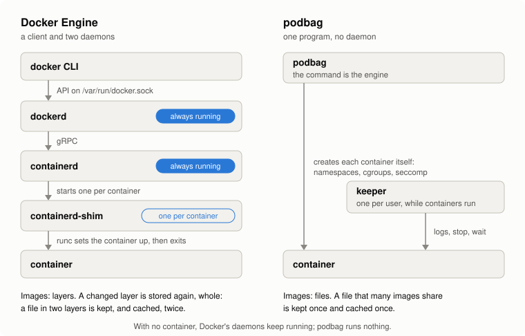

# podbag


デーモンのないコンテナエンジンです。静的バイナリ1つで動きます。
イメージをファイル単位で保存します。複数のイメージが同じファイルを使う場合、保存は1回だけです。
コマンドラインまたは [Podbag Desktop](#podbag-desktop) を利用できます。

[](https://github.com/SteelCrab/podbag/actions/workflows/ci.yml)
[](https://github.com/SteelCrab/podbag/releases/latest)
[](https://crates.io/crates/podbag)
[](LICENSE)
[](https://podbag.dev)

[English](README.md) · [한국어](README.ko.md) · **日本語** · [简体中文](README.zh-CN.md) · [Filipino](README.fil.md) · [Español](README.es.md) · [Tiếng Việt](README.vi.md)


<sub>同じ紹介を動画でも見られます（英語）: [intro.mp4](docs/media/intro.mp4).</sub>

## 目次

- [特徴](#特徴)
- [Podbag Desktop](#podbag-desktop)
- [インストール](#インストール)
- [使い方](#使い方)
- [ベンチマーク](#ベンチマーク)
- [他のツールとの比較](#他のツールとの比較)
- [ドキュメント](#ドキュメント)
- [コントリビュート](#コントリビュート)
- [ライセンス](#ライセンス)

## 特徴

- **イメージ間でファイルを共有。** レイヤーが異なっても、同一のファイルはディスク領域と Linux のページキャッシュを共有できます。
- **必要なときだけ動く Linux エンジン。** 1 つのプロセスがユーザーのコンテナを管理します。最後のコンテナが停止し、待機時間が過ぎると、このプロセスも終了します。
- **macOS の仮想マシンを自動停止。** 既定では、アイドル状態が 60 秒続くと Linux 仮想マシンが停止します。次のコンテナコマンドで再び起動します。
- **Kubernetes ノードのランタイム（`v0.2.0`）。** Linux で `podbag cri serve` を実行すると、kubelet が Podbag で Pod を起動できます。
- **エンジン間の移行（`v0.2.0`）。** Docker 互換エンジン間でイメージ、ボリューム、停止中のコンテナをコピーできます。移行元のデータは保持されます。

<picture><source media="(max-width: 600px) and (prefers-color-scheme: dark)" srcset="docs/images/storage-ja-tall-dark.svg"><source media="(max-width: 600px)" srcset="docs/images/storage-ja-tall-light.svg"><source media="(prefers-color-scheme: dark)" srcset="docs/images/storage-ja-dark.svg"></picture>

## Podbag Desktop

Linux と macOS でコンテナ、イメージ、ボリューム、ネットワークを管理できます。Windows のサポートは実験段階で、WSL 2 が必要です。一覧からコンテナを起動、停止、再起動できます。コンテナを開くとログをリアルタイムで確認できます。


[Linux パッケージのインストール手順](docs/build.md#linux-desktop-packages)と[ソースからのビルド手順](docs/usage.md#build-the-desktop-app)を参照してください。

## インストール

### Linux（x86_64、arm64）と macOS（Apple silicon）

```sh
curl -fsSL https://podbag.dev/install.sh | sh
podbag --version
```

インストーラーはリリースファイルの SHA-256 を確認し、CLI を `/usr/local/bin` にインストールします。更新時も同じスクリプトを実行します。

Linux カーネル 5.12 以降と cgroup v2 が必要です。`podbag check` で不足している項目を確認できます。一般ユーザーでブリッジネットワークを使う場合は `uidmap` と `passt` パッケージを確認してください。[Linux の要件](docs/usage.md#requirements-on-linux)

手動でインストールする場合は、OS と CPU に合うファイルをダウンロードし、`SHA256SUMS` と照合します。[リリースのダウンロード](https://github.com/SteelCrab/podbag/releases/latest)

### Windows（実験的サポート）

管理者権限の PowerShell で `wsl --install` を実行し、Windows を再起動します。CPU に合った `podbag-x86_64-windows.exe` または `podbag-aarch64-windows.exe` をダウンロードします。SHA-256 を `SHA256SUMS` と照合したら、ファイル名を `podbag.exe` に変更します。[リリースのダウンロード](https://github.com/SteelCrab/podbag/releases/latest)

```powershell
.\podbag.exe run --rm alpine echo hello
```

### その他のインストール方法

- **Linux 用の Cargo パッケージ。** `cargo install --locked podbag` で公開版の CLI をインストールします。
- **Linux デスクトップアプリ。** GitHub Actions から CPU に合ったアーカイブをダウンロードして展開し、`.deb` または `.rpm` をインストールします。エンジンも同梱されています。[デスクトップパッケージの手順](docs/build.md#linux-desktop-packages)
- **ソースからビルド。** Rust で CLI と Podbag Desktop をビルドします。 [ビルド手順](docs/build.md)

## 使い方

### コンテナを実行する

次のコマンドは `hello` を表示し、実行後にコンテナを削除します。

```sh
podbag run --rm alpine echo hello
```

ポート 8080 で nginx を起動し、リクエストを送ってアクセスログを確認します。

```sh
podbag run -d --name web -p 8080:80 nginx:alpine
podbag ps
curl -I http://localhost:8080/
podbag logs web
podbag exec web nginx -v
podbag stop web && podbag rm web
```

### Docker CLI と Compose

Linux で一般ユーザーとして実行する場合（`XDG_RUNTIME_DIR` の設定が必要）

```sh
podbag system service &
podbag_socket="unix://$XDG_RUNTIME_DIR/podbag/docker.sock"
```

macOS

```sh
podbag vm start
podbag_socket="unix://$HOME/.podbag/run/docker.sock"
```

ソケットを設定したら、公開済みのイメージを使う `compose.yaml` があるディレクトリで実行します。

```sh
docker --host "$podbag_socket" ps
docker --host "$podbag_socket" compose up -d
docker --host "$podbag_socket" compose down
```

### Docker からイメージをコピーする（`v0.2.0`）

両方のエンジンを起動します。Docker に `alpine:latest` イメージがある場合は、Podbag CLI v0.2.0 以降で Podbag にコピーできます。

```sh
podbag migrate --from docker --to podbag image alpine:latest
```

[移行の手順](docs/usage.md#migrate-between-engines-or-kubernetes-clusters) · [コマンド一覧](docs/usage.md)

## ベンチマーク


<sub>同じ比較を動画で（英語）: [perf.mp4](docs/media/perf.mp4).</sub>

<table>
<tr>
<td><picture><source media="(prefers-color-scheme: dark)" srcset="docs/images/start-dark.svg"></picture></td>
<td><picture><source media="(prefers-color-scheme: dark)" srcset="docs/images/memory-dark.svg"></picture></td>
</tr>
<tr>
<td><picture><source media="(prefers-color-scheme: dark)" srcset="docs/images/disk-dark.svg"></picture></td>
<td><picture><source media="(prefers-color-scheme: dark)" srcset="docs/images/cache-dark.svg"></picture></td>
</tr>
</table>

- Linux VM 1台で測った中央値です: 4 CPU、3.8 GiB、arm64。
- バージョン: podbag 0.1.0、Podman 5.7.0、Docker 29.1.3、Kiri 0.2.1。
- すべての数値と測り方: [docs/benchmarks.md](docs/benchmarks.md)、[docs/benchmarks-msa.md](docs/benchmarks-msa.md)（英語）。
- k3s のノードのランタイムとして pod を 30 個動かすと、podbag はプロセス 2 個で 3.5 MiB です。containerd は 63 個（276 MiB）、CRI-O は 32 個（85 MiB）です。[docs/benchmarks-k8s.md](docs/benchmarks-k8s.md)（英語）。

## 他のツールとの比較

| | podbag | Docker | OrbStack | Colima | Kiri |
|---|---|---|---|---|---|
| 動く環境 | Linux、macOS、Windows¹ | Linux。macOS と Windows は Docker Desktop | macOS | macOS、Linux | Linux、macOS、Windows |
| バックグラウンドで動くもの | 最後のコンテナが終われば何もなし（Mac: 2 MiB の待機プロセス） | `dockerd`、`containerd`、コンテナごとの shim | Docker Engine 入りの Linux VM | Docker か containerd 入りの Lima VM | デーモン。macOS と Windows では小さな VM |
| イメージの保存 | ファイル（各1回） | レイヤー | レイヤー | レイヤー | レイヤー（初回使用時に展開） |
| Mac: `docker run` の起動、中央値² | 14.4 ms | 97.4 ms | 90.4 ms | 73.6 ms | 11.8 ms |
| Mac: 最後のコンテナから6分後のメモリ² | 1.7 MiB | 950 MiB | 795 MiB | 1.54 GiB | 12 MiB |
| ライセンス | Apache-2.0 | Apache-2.0。Docker Desktop は大企業では有料 | プロプライエタリ | MIT | Apache-2.0 |

¹ 実験的。² Mac 1台で測定。Docker は Docker Desktop です: [docs/benchmarks.md](docs/benchmarks.md)。

<picture><source media="(prefers-color-scheme: dark)" srcset="docs/images/architecture-dark.svg"></picture>

- 仕組みと、podbag がまだ遅れている点: [docs/architecture.md](docs/architecture.md)（英語）。

## ドキュメント

以下のドキュメントは英語です。

- [使い方](docs/usage.md): コマンド、ボリューム、ネットワーク、制限、Docker API、TUI と GUI、macOS、Windows。
- [アーキテクチャ](docs/architecture.md): podbag と Docker の違い。
- [ソースからビルド](docs/build.md): Linux、macOS、Windows。
- [ベンチマーク](docs/benchmarks.md) と [Spring マイクロサービスのベンチマーク](docs/benchmarks-msa.md)。

## コントリビュート

- Issue とプルリクエストを歓迎します。
- [CONTRIBUTING.md](CONTRIBUTING.md) をご覧ください（英語）。

## ライセンス

[Apache License 2.0](LICENSE)
