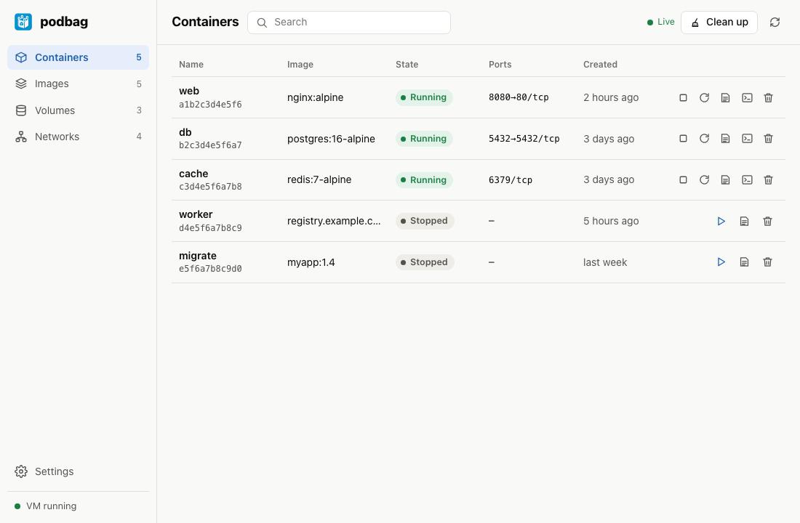
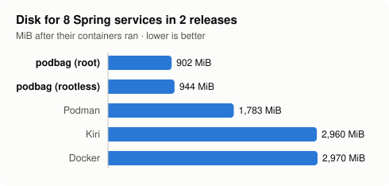

# podbag


데몬 없는 컨테이너 엔진입니다. 정적 바이너리 하나로 동작합니다.
이미지를 파일 단위로 저장합니다. 여러 이미지가 같은 파일을 쓰면 한 번만 저장합니다.
명령줄이나 [Podbag Desktop](#podbag-desktop)을 사용할 수 있습니다.

[](https://github.com/SteelCrab/podbag/actions/workflows/ci.yml)
[](https://github.com/SteelCrab/podbag/releases/latest)
[](https://crates.io/crates/podbag)
[](LICENSE)
[](https://podbag.dev)

[English](README.md) · **한국어** · [日本語](README.ja.md) · [简体中文](README.zh-CN.md) · [Filipino](README.fil.md) · [Español](README.es.md) · [Tiếng Việt](README.vi.md)


<sub>같은 소개를 영상으로도 볼 수 있습니다(영문): [intro.mp4](docs/media/intro.mp4).</sub>

## 목차

- [특징](#특징)
- [Podbag Desktop](#podbag-desktop)
- [설치](#설치)
- [사용법](#사용법)
- [벤치마크](#벤치마크)
- [다른 도구와 비교](#다른-도구와-비교)
- [문서](#문서)
- [기여](#기여)
- [라이선스](#라이선스)

## 특징

- **데몬이 없습니다.** 컨테이너가 없으면 아무것도 돌지 않습니다.
- **정적 바이너리 하나.** Linux에서 약 4 MB입니다.
- **레이어가 아니라 파일.** 여러 이미지가 같은 파일을 쓰면 디스크와 메모리에 한 번만 둡니다.
- **빠릅니다.** Linux에서 컨테이너가 약 4 ms 만에 시작됩니다.
- **Docker 도구와 함께 씁니다.** Docker·OCI 이미지, `docker` CLI, Compose, buildx를 지원합니다.
- **Dockerfile을 빌드합니다.** `podbag build`와 클래식 빌더의 `docker build`를 씁니다. BuildKit과 데몬이 없어도 됩니다.
- **root 없이도, root로도.** 같은 프로그램이 두 방식으로 동작합니다.
- **Linux, macOS, Windows.** x86_64와 arm64를 지원합니다. Windows 지원은 실험 단계입니다.
- **TUI와 데스크톱 앱이 있습니다.** 터미널에서는 `podbag tui`, 데스크톱에서는 메뉴 막대 아이콘이 있는 창으로 컨테이너, 이미지, 볼륨, 네트워크를 다룹니다.

### 레이어와 파일

<picture><source media="(max-width: 600px) and (prefers-color-scheme: dark)" srcset="docs/images/storage-ko-tall-dark.svg"><source media="(max-width: 600px)" srcset="docs/images/storage-ko-tall-light.svg"><source media="(prefers-color-scheme: dark)" srcset="docs/images/storage-ko-dark.svg"></picture>

- 레이어 방식(Docker, Podman, Kiri)은 레이어 전체가 같을 때만 한 번 저장합니다. 파일 하나만 달라도 레이어 전체를 다시 저장하고, 다른 레이어와 같은 파일도 함께 다시 저장됩니다.
- podbag은 파일 하나하나를 한 번만 저장합니다. 이미지는 그 파일들을 가리키는 경로 목록입니다.
- Spring 서비스 8개, 릴리스 2개 기준: 디스크 902 MiB(Docker 2,970 MiB), 페이지 캐시 324 MiB(Docker 982 MiB).

## Podbag Desktop

Linux와 macOS에서 컨테이너, 이미지, 볼륨, 네트워크를 관리합니다. Windows 지원은 실험 단계입니다. Windows에서는 WSL 2가 필요합니다. 목록에서 컨테이너를 시작, 중지 또는 재시작할 수 있습니다. 컨테이너를 열면 실시간 로그를 볼 수 있습니다.



[Linux 패키지 설치 안내](docs/build.md#linux-desktop-packages) · [데스크톱 앱 소스 빌드 안내](docs/usage.md#build-the-desktop-app)

## 설치

### 설치 스크립트 (Linux, macOS)

```sh
curl -fsSL https://podbag.dev/install.sh | sh
```

- 시스템에 맞는 파일을 받고 SHA-256 값을 확인합니다.
- `/usr/local/bin`에 설치합니다. 필요하면 `sudo`를 씁니다.
- Ubuntu 24.04 이상에서는 rootless 컨테이너에 필요한 AppArmor 프로필을 추가합니다.
- 설정: `PODBAG_VERSION=v0.1.0`, `PODBAG_INSTALL_DIR=$HOME/.local/bin`,
  `PODBAG_SKIP_APPARMOR=1`.

### 직접 내려받기

[최신 릴리스](https://github.com/SteelCrab/podbag/releases/latest)에서 파일을 받습니다. `SHA256SUMS`로 파일을 확인합니다.

| 시스템 | 파일 |
|---|---|
| Linux, x86_64 | `podbag-x86_64-linux` |
| Linux, arm64 | `podbag-aarch64-linux` |
| macOS, Apple silicon | `podbag-aarch64-macos` |
| Windows, x86_64 (실험) | `podbag-x86_64-windows.exe` |
| Windows, arm64 (실험) | `podbag-aarch64-windows.exe` |

Windows에는 WSL 2가 필요합니다(`wsl --install`을 한 번 실행합니다):

```powershell
curl.exe -fsSLo podbag.exe https://github.com/SteelCrab/podbag/releases/latest/download/podbag-x86_64-windows.exe
.\podbag.exe run --rm alpine echo hello
```

### Cargo

```sh
cargo install podbag
```

- Linux용입니다. macOS와 Windows에서는 릴리스 파일을 쓰세요. 릴리스 파일에는 VM과 Linux 엔진이 들어 있습니다.

### 소스에서 빌드

- Linux, macOS, Windows 빌드 방법은 [docs/build.md](docs/build.md)에 있습니다(영문).

### 요구 사항과 AppArmor (Linux)

- Linux 5.12 이상, cgroup v2.
- root 없이 쓰려면 다음도 필요합니다:
  - `newuidmap` (패키지 `uidmap`),
  - 네트워크용 `pasta` (패키지 `passt`),
  - Ubuntu 24.04 이상에서는 AppArmor 프로필. 설치 스크립트가 추가합니다. 직접 하려면:

    ```sh
    podbag check --apparmor-profile | sudo tee /etc/apparmor.d/podbag >/dev/null
    sudo apparmor_parser -r /etc/apparmor.d/podbag
    ```

- `podbag check`는 시스템에 아직 필요한 것과 그 추가 방법을 보여 줍니다.

## 사용법

### 기본 명령

```sh
podbag run --rm alpine echo hello                 # 필요하면 이미지를 받고, 실행하고, 지웁니다
podbag run -d --name web -p 8080:80 nginx:alpine  # 백그라운드에서 실행합니다
podbag ps                                         # 컨테이너 목록
podbag logs -f web                                # 로그를 따라 봅니다
podbag exec -it web sh                            # 컨테이너 안에서 셸을 엽니다
podbag stats --no-stream                          # CPU, 메모리, 네트워크 사용량
podbag stop web && podbag rm web                  # 멈추고 지웁니다
podbag images                                     # 이미지 목록
podbag build -t myapp .                           # Dockerfile로 이미지를 빌드합니다
podbag login ghcr.io                              # 레지스트리에 로그인합니다 (docker login과 공유)
podbag push ghcr.io/me/app:1                      # 이미지를 레지스트리로 보냅니다
```

### docker CLI, Compose, buildx

```sh
podbag system service &      # Linux (macOS: podbag vm start)
export DOCKER_HOST=unix://$XDG_RUNTIME_DIR/podbag/docker.sock   # macOS: unix://$HOME/.podbag/run/docker.sock
docker compose up -d
```

- 모든 명령과 옵션: [docs/usage.md](docs/usage.md) (영문).

## 벤치마크


<sub>같은 비교를 영상으로 (영어): [perf.mp4](docs/media/perf.mp4).</sub>

<table>
<tr>
<td><picture><source media="(prefers-color-scheme: dark)" srcset="docs/images/start-dark.svg"></picture></td>
<td><picture><source media="(prefers-color-scheme: dark)" srcset="docs/images/memory-dark.svg"></picture></td>
</tr>
<tr>
<td><picture><source media="(prefers-color-scheme: dark)" srcset="docs/images/disk-dark.svg"></picture></td>
<td><picture><source media="(prefers-color-scheme: dark)" srcset="docs/images/cache-dark.svg"></picture></td>
</tr>
</table>

- Linux VM 한 대에서 잰 중앙값입니다: 4 CPU, 3.8 GiB, arm64.
- 버전: podbag 0.1.0, Podman 5.7.0, Docker 29.1.3, Kiri 0.2.1.
- 모든 수치와 측정 방법: [docs/benchmarks.md](docs/benchmarks.md), [docs/benchmarks-msa.md](docs/benchmarks-msa.md) (영문).

## 다른 도구와 비교

| | podbag | Docker | OrbStack | Colima | Kiri |
|---|---|---|---|---|---|
| 실행 환경 | Linux, macOS, Windows¹ | Linux; macOS·Windows는 Docker Desktop | macOS | macOS, Linux | Linux, macOS, Windows |
| 백그라운드 실행 | 마지막 컨테이너가 끝나면 없음 (Mac: 2 MiB 대기 프로세스) | `dockerd`, `containerd`, 컨테이너마다 shim | Docker Engine이 든 Linux VM | Docker나 containerd가 든 Lima VM | 데몬; macOS·Windows에서는 작은 VM |
| 이미지 저장 | 파일, 각각 한 번 | 레이어 | 레이어 | 레이어 | 레이어, 처음 쓸 때 풂 |
| Mac: `docker run` 시작, 중앙값² | 14.4 ms | 97.4 ms | 90.4 ms | 73.6 ms | 11.8 ms |
| Mac: 마지막 컨테이너 6분 뒤 메모리² | 1.7 MiB | 950 MiB | 795 MiB | 1.54 GiB | 12 MiB |
| 라이선스 | Apache-2.0 | Apache-2.0; Docker Desktop은 큰 회사에 유료 | 독점 | MIT | Apache-2.0 |

¹ 실험 단계. ² Mac 한 대에서 측정했습니다. Docker는 Docker Desktop입니다: [docs/benchmarks.md](docs/benchmarks.md).

<picture><source media="(prefers-color-scheme: dark)" srcset="docs/images/architecture-dark.svg"></picture>

- 구조와, podbag이 아직 뒤처지는 점: [docs/architecture.md](docs/architecture.md) (영문).

## 문서

아래 문서는 영문입니다.

- [사용법](docs/usage.md): 명령, 볼륨, 네트워크, 제한, Docker API, TUI와 GUI, macOS, Windows.
- [구조](docs/architecture.md): podbag과 Docker의 차이.
- [소스에서 빌드](docs/build.md): Linux, macOS, Windows.
- [벤치마크](docs/benchmarks.md)와 [Spring 마이크로서비스 벤치마크](docs/benchmarks-msa.md).

## 기여

- 이슈와 풀 리퀘스트를 환영합니다.
- [CONTRIBUTING.md](CONTRIBUTING.md)를 보세요(영문).

## 라이선스

[Apache License 2.0](LICENSE)
