# podbag


데몬 없는 컨테이너 엔진입니다. 정적 바이너리 하나로 동작합니다.
이미지를 파일 단위로 저장합니다. 여러 이미지가 같은 파일을 쓰면 한 번만 저장합니다.
명령줄이나 [Podbag Desktop](#podbag-desktop)을 사용할 수 있습니다.

[](https://github.com/SteelCrab/podbag/actions/workflows/ci.yml)
[](https://github.com/SteelCrab/podbag/releases/latest)
[](https://crates.io/crates/podbag)
[](LICENSE)
[](https://podbag.dev)

[English](README.md) · **한국어** · [日本語](README.ja.md) · [简体中文](README.zh-CN.md) · [Filipino](README.fil.md) · [Español](README.es.md) · [Tiếng Việt](README.vi.md)


<sub>같은 소개를 영상으로도 볼 수 있습니다(영문): [intro.mp4](docs/media/intro.mp4).</sub>

## 목차

- [특징](#특징)
- [Podbag Desktop](#podbag-desktop)
- [설치](#설치)
- [사용법](#사용법)
- [벤치마크](#벤치마크)
- [다른 도구와 비교](#다른-도구와-비교)
- [문서](#문서)
- [기여](#기여)
- [라이선스](#라이선스)

## 특징

- **이미지 간 파일 공유.** 서로 다른 레이어에 같은 파일이 있으면 디스크 공간과 Linux 페이지 캐시를 공유할 수 있습니다.
- **필요할 때만 실행되는 Linux 엔진.** 프로세스 하나가 사용자의 컨테이너를 관리합니다. 마지막 컨테이너가 멈추고 대기 시간이 지나면 이 프로세스도 종료됩니다.
- **macOS 가상 머신 자동 종료.** 기본 설정에서는 60초 동안 유휴 상태가 지속되면 Linux 가상 머신이 종료됩니다. 다음 컨테이너 명령을 실행하면 다시 시작합니다.
- **Kubernetes 노드 런타임(`v0.2.0`).** Linux에서 `podbag cri serve`를 실행하면 kubelet이 Podbag으로 파드를 실행할 수 있습니다.
- **엔진 간 이전(`v0.2.0`).** Docker 호환 엔진 사이에서 이미지, 볼륨, 중지된 컨테이너를 복사합니다. 원본은 그대로 유지합니다.

<picture><source media="(max-width: 600px) and (prefers-color-scheme: dark)" srcset="docs/images/storage-ko-tall-dark.svg"><source media="(max-width: 600px)" srcset="docs/images/storage-ko-tall-light.svg"><source media="(prefers-color-scheme: dark)" srcset="docs/images/storage-ko-dark.svg"></picture>

## Podbag Desktop

Linux와 macOS에서 컨테이너, 이미지, 볼륨, 네트워크를 관리합니다. Windows 지원은 실험 단계입니다. Windows에서는 WSL 2가 필요합니다. 목록에서 컨테이너를 시작, 중지 또는 재시작할 수 있습니다. 컨테이너를 열면 실시간 로그를 볼 수 있습니다.


[Podbag Desktop 설치](#설치) · [데스크톱 앱 소스 빌드 안내](docs/usage.md#build-the-desktop-app)

## 설치

### Podbag Desktop (권장)

[최신 릴리스](https://github.com/SteelCrab/podbag/releases/latest)에서 시스템에 맞는 패키지를 받습니다.

- **Linux(x86_64, arm64).** Debian과 Ubuntu에서는 `.deb`를 설치합니다. Fedora에서는 `.rpm`을 설치합니다. 패키지에 엔진이 포함됩니다.
- **macOS(Apple silicon, Intel).** `podbag-desktop-aarch64-macos.dmg`(Apple silicon) 또는 `podbag-desktop-x86_64-macos.dmg`(Intel)를 엽니다. `podbag`을 응용 프로그램 폴더로 끌어다 놓은 다음 응용 프로그램 폴더에서 엽니다. 처음 열 때는 한 번 허용해야 합니다: [macOS에서 처음 열기](#macos에서-처음-열기).
- **Windows(x86_64, ARM64, 실험 단계).** CPU에 맞는 `.msi`를 실행합니다. 릴리스에 MSI가 없으면 성공한 [CI 실행](https://github.com/SteelCrab/podbag/actions/workflows/ci.yml?query=branch%3Amain)에서 받습니다. 컨테이너를 실행하려면 WSL 2를 활성화합니다.

앱에는 CLI가 포함됩니다. 터미널에 `podbag`이 없으면 앱이 `podbag` 명령 설치를 제안합니다. 이 명령은 앱의 CLI를 사용하므로 앱과 함께 업데이트됩니다.

### macOS에서 처음 열기

podbag은 Apple의 공증을 받지 않았습니다. 그래서 브라우저로 받은 앱이나 CLI는 한 번 허용할 때까지 macOS가 막습니다.

1. 응용 프로그램 폴더에서 `podbag`을 엽니다. macOS가 악성 코드를 확인할 수 없다고 알립니다. **완료**를 누릅니다.
2. **시스템 설정 > 개인정보 보호 및 보안**을 엽니다. `podbag`에 관한 메시지 옆의 **그래도 열기**를 누르고 암호로 확인합니다.

이 과정을 건너뛰려면 터미널로 설치합니다. `curl`로 받은 파일은 막히지 않습니다.

```sh
curl -fsSL https://podbag.dev/install.sh | PODBAG_DESKTOP=1 sh   # Podbag Desktop
curl -fsSL https://podbag.dev/install.sh | sh                    # CLI만
```

### Linux(x86_64, arm64)와 macOS(Apple silicon, Intel)용 CLI

```sh
curl -fsSL https://podbag.dev/install.sh | sh
podbag --version
```

설치 스크립트는 릴리스 파일의 SHA-256 값을 확인하고 CLI를 `/usr/local/bin`에 설치합니다. 업데이트할 때도 같은 스크립트를 실행합니다.

Linux 커널 5.12 이상과 cgroup v2가 필요합니다. `podbag check`로 빠진 항목을 확인합니다. 일반 사용자로 브리지 네트워크를 사용하려면 `uidmap`과 `passt` 패키지를 확인합니다. [Linux 실행 요건](docs/usage.md#requirements-on-linux)

직접 설치하려면 운영체제와 CPU에 맞는 파일을 받고 `SHA256SUMS`로 검증합니다. `chmod +x`로 실행 권한을 줍니다. Mac에서는 `xattr -d com.apple.quarantine`도 실행합니다. [릴리스 다운로드](https://github.com/SteelCrab/podbag/releases/latest)

### Windows용 CLI(실험 단계)

관리자 PowerShell에서 `wsl --install`을 실행한 뒤 Windows를 다시 시작합니다. CPU에 맞는 `podbag-x86_64-windows.exe` 또는 `podbag-aarch64-windows.exe`를 받습니다. SHA-256 값을 `SHA256SUMS`와 대조한 뒤 파일 이름을 `podbag.exe`로 바꿉니다. [릴리스 다운로드](https://github.com/SteelCrab/podbag/releases/latest)

```powershell
.\podbag.exe run --rm alpine echo hello
```

### 다른 설치 방법

- **Linux용 Cargo 패키지.** `cargo install --locked podbag`으로 배포된 CLI를 설치합니다.
- **소스 빌드.** Rust로 CLI와 Podbag Desktop을 빌드합니다. [소스 빌드 안내](docs/build.md)

## 사용법

### 컨테이너 실행

다음 명령은 `hello`를 출력합니다. 실행이 끝나면 컨테이너가 자동으로 삭제됩니다.

```sh
podbag run --rm alpine echo hello
```

nginx를 8080 포트에서 실행합니다. 요청을 보낸 뒤 접근 로그를 확인합니다.

```sh
podbag run -d --name web -p 8080:80 nginx:alpine
podbag ps
curl -I http://localhost:8080/
podbag logs web
podbag exec web nginx -v
podbag stop web && podbag rm web
```

### Docker CLI와 Compose

Linux에서 일반 사용자로 실행하고 `XDG_RUNTIME_DIR`가 설정된 경우

```sh
podbag system service &
podbag_socket="unix://$XDG_RUNTIME_DIR/podbag/docker.sock"
```

macOS

```sh
podbag vm start
podbag_socket="unix://$HOME/.podbag/run/docker.sock"
```

소켓을 설정한 뒤 `compose.yaml`이 있는 디렉터리에서 실행합니다. 이 예시는 레지스트리에 배포된 이미지를 사용합니다.

```sh
docker --host "$podbag_socket" ps
docker --host "$podbag_socket" compose up -d
docker --host "$podbag_socket" compose down
```

### Docker에서 이미지 복사(`v0.2.0`)

두 엔진을 시작합니다. Docker에 `alpine:latest` 이미지가 있으면 Podbag CLI v0.2.0 이상으로 Podbag에 복사합니다.

```sh
podbag migrate --from docker --to podbag image alpine:latest
```

[이전 안내](docs/usage.md#migrate-between-engines-or-kubernetes-clusters) · [전체 명령 안내](docs/usage.md)

## 벤치마크



<sub>같은 비교를 영상으로 (영어): [perf.mp4](docs/media/perf.mp4).</sub>

<table>
<tr>
<td><picture><source media="(prefers-color-scheme: dark)" srcset="docs/images/start-dark.svg"></picture></td>
<td><picture><source media="(prefers-color-scheme: dark)" srcset="docs/images/memory-dark.svg"></picture></td>
</tr>
<tr>
<td><picture><source media="(prefers-color-scheme: dark)" srcset="docs/images/disk-dark.svg"></picture></td>
<td><picture><source media="(prefers-color-scheme: dark)" srcset="docs/images/cache-dark.svg"></picture></td>
</tr>
</table>

- Linux VM 한 대에서 잰 중앙값입니다: 4 CPU, 3.8 GiB, arm64.
- 버전: podbag 0.1.0, Podman 5.7.0, Docker 29.1.3, Kiri 0.2.1.
- 모든 수치와 측정 방법: [docs/benchmarks.md](docs/benchmarks.md), [docs/benchmarks-msa.md](docs/benchmarks-msa.md) (영문).
- k3s 노드의 런타임으로 pod 30개를 실행할 때: podbag은 프로세스 2개, 3.5 MiB입니다. containerd는 63개(276 MiB), CRI-O는 32개(85 MiB)입니다. [docs/benchmarks-k8s.md](docs/benchmarks-k8s.md) (영문).

## 다른 도구와 비교

| | podbag | Docker | OrbStack | Colima | Kiri |
|---|---|---|---|---|---|
| 실행 환경 | Linux, macOS, Windows¹ | Linux; macOS·Windows는 Docker Desktop | macOS | macOS, Linux | Linux, macOS, Windows |
| 백그라운드 실행 | 마지막 컨테이너가 끝나면 없음 (Mac: 2 MiB 대기 프로세스) | `dockerd`, `containerd`, 컨테이너마다 shim | Docker Engine이 든 Linux VM | Docker나 containerd가 든 Lima VM | 데몬; macOS·Windows에서는 작은 VM |
| 이미지 저장 | 파일, 각각 한 번 | 레이어 | 레이어 | 레이어 | 레이어, 처음 쓸 때 풂 |
| Mac: `docker run` 시작, 중앙값² | 14.4 ms | 97.4 ms | 90.4 ms | 73.6 ms | 11.8 ms |
| Mac: 마지막 컨테이너 6분 뒤 메모리² | 1.7 MiB | 950 MiB | 795 MiB | 1.54 GiB | 12 MiB |
| 라이선스 | Apache-2.0 | Apache-2.0; Docker Desktop은 큰 회사에 유료 | 독점 | MIT | Apache-2.0 |

¹ 실험 단계. ² Mac 한 대에서 측정했습니다. Docker는 Docker Desktop입니다: [docs/benchmarks.md](docs/benchmarks.md).

<picture><source media="(prefers-color-scheme: dark)" srcset="docs/images/architecture-dark.svg"></picture>

- 구조와, podbag이 아직 뒤처지는 점: [docs/architecture.md](docs/architecture.md) (영문).

## 문서

아래 문서는 영문입니다.

- [사용법](docs/usage.md): 명령, 볼륨, 네트워크, 제한, Docker API, TUI와 GUI, macOS, Windows.
- [구조](docs/architecture.md): podbag과 Docker의 차이.
- [소스에서 빌드](docs/build.md): Linux, macOS, Windows.
- [벤치마크](docs/benchmarks.md)와 [Spring 마이크로서비스 벤치마크](docs/benchmarks-msa.md).

## 기여

- 이슈와 풀 리퀘스트를 환영합니다.
- [CONTRIBUTING.md](CONTRIBUTING.md)를 보세요(영문).

## 라이선스

[Apache License 2.0](LICENSE)
