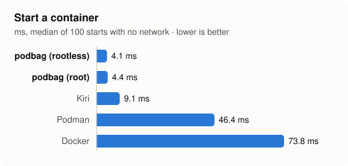

# podbag

A container engine with no daemon, in one static binary. It runs Docker and OCI images,
rootless or as root, and stores them file by file: a file that many images share is kept
on disk, and read into memory, once.

[](https://github.com/SteelCrab/podbag/actions/workflows/ci.yml)
[](https://github.com/SteelCrab/podbag/releases/latest)
[](LICENSE)


<sub>The same intro as a video: [intro.mp4](docs/media/intro.mp4).</sub>

- **Linux** (x86_64, arm64): runs containers itself. With no container, nothing runs.
- **macOS** (Apple silicon): starts a small Linux VM of its own when it is needed.
- **Windows** (x86_64, arm64): runs in a WSL 2 distribution of its own. *Experimental.*
- Works with the `docker` CLI, Docker Compose and buildx through its Docker API.

## Install

Linux:

```sh
curl -fsSLo podbag https://github.com/SteelCrab/podbag/releases/latest/download/podbag-$(uname -m)-linux
sudo install -m 0755 podbag /usr/local/bin/podbag
podbag check    # what this system still needs, and how to add it
```

Without root, podbag needs `newuidmap` (package `uidmap`), `pasta` (package `passt`) for
networks, and on Ubuntu 24.04 or later an AppArmor profile. `podbag check` says which.

macOS (Apple silicon):

```sh
curl -fsSLo podbag https://github.com/SteelCrab/podbag/releases/latest/download/podbag-aarch64-macos
sudo mkdir -p /usr/local/bin && sudo install -m 0755 podbag /usr/local/bin/podbag
```

Windows (experimental, needs WSL 2: `wsl --install`):

```powershell
curl.exe -fsSLo podbag.exe https://github.com/SteelCrab/podbag/releases/latest/download/podbag-x86_64-windows.exe
.\podbag.exe run --rm alpine echo hello
```

On arm64, download `podbag-aarch64-windows.exe`. Each release lists the SHA-256 sums of its
files.

## Use

```sh
podbag run --rm alpine echo hello                 # pulls the image if needed
podbag run -d --name web -p 8080:80 nginx:alpine  # in the background
podbag ps
podbag logs -f web
podbag exec -it web sh
podbag stop web && podbag rm web
podbag images
```

The `docker` CLI, Compose and buildx work through podbag's Docker API:

```sh
podbag system service &      # Linux (on macOS: podbag vm start)
export DOCKER_HOST=unix://$XDG_RUNTIME_DIR/podbag/docker.sock   # macOS: unix://$HOME/.podbag/run/docker.sock
docker compose up -d
```

Volumes, networks, limits, and the details for macOS and Windows:
[docs/usage.md](docs/usage.md).

## Benchmarks

<table>
<tr>
<td><picture><source media="(prefers-color-scheme: dark)" srcset="docs/images/start-dark.svg"></picture></td>
<td><picture><source media="(prefers-color-scheme: dark)" srcset="docs/images/memory-dark.svg"></picture></td>
</tr>
<tr>
<td><picture><source media="(prefers-color-scheme: dark)" srcset="docs/images/disk-dark.svg"></picture></td>
<td><picture><source media="(prefers-color-scheme: dark)" srcset="docs/images/cache-dark.svg"></picture></td>
</tr>
</table>

Medians on one Linux VM (4 CPUs, 3.8 GiB, arm64) with podbag 0.1.0, Podman 5.7.0,
Docker 29.1.3 and Kiri 0.2.1. How each was measured, and every number:
[docs/benchmarks.md](docs/benchmarks.md) and [docs/benchmarks-msa.md](docs/benchmarks-msa.md).

## Compared with other tools

| | podbag | Docker | OrbStack | Colima | Kiri |
|---|---|---|---|---|---|
| Runs on | Linux, macOS, Windows¹ | Linux; macOS and Windows with Docker Desktop | macOS | macOS, Linux | Linux, macOS, Windows |
| Runs in the background | nothing once the last container ends (Mac: a 2 MiB standby) | `dockerd`, `containerd`, a shim per container | a Linux VM with Docker Engine | a Lima VM with Docker or containerd | a daemon; on macOS and Windows a small VM |
| Image storage | files, each kept once | layers | layers | layers | layers, unpacked when first used |
| Mac: `docker run` start, median² | 14.4 ms | 97.4 ms | 90.4 ms | 73.6 ms | 11.8 ms |
| Mac: memory 6 minutes after the last container² | 1.7 MiB | 950 MiB | 795 MiB | 1.54 GiB | 12 MiB |
| License | Apache-2.0 | Apache-2.0; Docker Desktop is paid for larger companies | proprietary | MIT | Apache-2.0 |

¹ Experimental. ² Measured on one Mac with Docker Desktop for Docker:
[docs/benchmarks.md](docs/benchmarks.md).

<picture><source media="(prefers-color-scheme: dark)" srcset="docs/images/architecture-dark.svg"></picture>

How the parts fit, and where podbag is still behind: [docs/architecture.md](docs/architecture.md).

## Contributing

Issues and pull requests are welcome. See [CONTRIBUTING.md](CONTRIBUTING.md).

## License

[Apache License 2.0](LICENSE)
