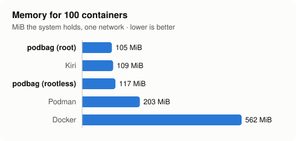

# podbag

A container engine with no daemon, in one static binary.
It stores images file by file: a file that many images share is kept once.

[](https://github.com/SteelCrab/podbag/actions/workflows/ci.yml)
[](https://github.com/SteelCrab/podbag/releases/latest)
[](https://crates.io/crates/podbag)
[](LICENSE)
[](https://podbag.dev)

**English** · [한국어](README.ko.md) · [日本語](README.ja.md) · [简体中文](README.zh-CN.md) · [Filipino](README.fil.md) · [Español](README.es.md) · [Tiếng Việt](README.vi.md)


<sub>The same intro as a video: [intro.mp4](docs/media/intro.mp4).</sub>

## Contents

- [Features](#features)
- [Install](#install)
- [Use](#use)
- [Benchmarks](#benchmarks)
- [Compared with other tools](#compared-with-other-tools)
- [Documentation](#documentation)
- [Contributing](#contributing)
- [License](#license)

## Features

- **No daemon.** When no container runs, nothing runs.
- **One static binary.** About 4 MB on Linux.
- **Files, not layers.** A file that many images share is stored once and cached once.
- **Fast.** A container starts in about 4 ms on Linux.
- **Works with Docker tools.** Docker and OCI images, the `docker` CLI, Compose and buildx.
- **With or without root.** The same program works both ways.
- **Linux, macOS and Windows.** x86_64 and arm64. Windows support is experimental.

### Layers and files

<picture><source media="(max-width: 600px) and (prefers-color-scheme: dark)" srcset="docs/images/storage-tall-dark.svg"><source media="(max-width: 600px)" srcset="docs/images/storage-tall-light.svg"><source media="(prefers-color-scheme: dark)" srcset="docs/images/storage-dark.svg"></picture>

- A layer store (Docker, Podman, Kiri) keeps a layer once only when the whole layer is the same. If one file differs, the whole layer is stored again, with the files it shares with other layers.
- podbag keeps each file once. An image is a list of paths that point to the files.
- For 8 Spring services in 2 releases: 902 MiB on disk against Docker's 2,970 MiB, and 324 MiB of page cache against 982 MiB.

## Install

### Install script (Linux and macOS)

```sh
curl -fsSL https://raw.githubusercontent.com/SteelCrab/podbag/main/install.sh | sh
```

- Downloads the file for your system and checks its SHA-256 sum.
- Installs it in `/usr/local/bin`, with `sudo` when needed.
- On Ubuntu 24.04 and later, adds the AppArmor profile that rootless containers need.
- Settings: `PODBAG_VERSION=v0.1.0`, `PODBAG_INSTALL_DIR=$HOME/.local/bin`,
  `PODBAG_SKIP_APPARMOR=1`.

### Download

Get a file from the [latest release](https://github.com/SteelCrab/podbag/releases/latest).
Check it with `SHA256SUMS`.

| System | File |
|---|---|
| Linux, x86_64 | `podbag-x86_64-linux` |
| Linux, arm64 | `podbag-aarch64-linux` |
| macOS, Apple silicon | `podbag-aarch64-macos` |
| Windows, x86_64 (experimental) | `podbag-x86_64-windows.exe` |
| Windows, arm64 (experimental) | `podbag-aarch64-windows.exe` |

Windows needs WSL 2 (run `wsl --install` once):

```powershell
curl.exe -fsSLo podbag.exe https://github.com/SteelCrab/podbag/releases/latest/download/podbag-x86_64-windows.exe
.\podbag.exe run --rm alpine echo hello
```

### Cargo

```sh
cargo install podbag
```

- For Linux. On macOS and Windows, use the release files: they carry the VM and the
  Linux engine.

### Build from source

- See [docs/build.md](docs/build.md) for Linux, macOS and Windows.

### Requirements and AppArmor (Linux)

- Linux 5.12 or later, with cgroup v2.
- Without root, podbag also needs:
  - `newuidmap` (package `uidmap`),
  - `pasta` (package `passt`) for networks,
  - an AppArmor profile on Ubuntu 24.04 and later. The install script adds it. By hand:

    ```sh
    podbag check --apparmor-profile | sudo tee /etc/apparmor.d/podbag >/dev/null
    sudo apparmor_parser -r /etc/apparmor.d/podbag
    ```

- `podbag check` lists what your system still needs, and how to add it.

## Use

### Basic commands

```sh
podbag run --rm alpine echo hello                 # pull the image if needed, run, remove
podbag run -d --name web -p 8080:80 nginx:alpine  # run in the background
podbag ps                                         # list containers
podbag logs -f web                                # follow the logs
podbag exec -it web sh                            # open a shell in the container
podbag stop web && podbag rm web                  # stop and remove
podbag images                                     # list images
```

### docker CLI, Compose and buildx

```sh
podbag system service &      # Linux (on macOS: podbag vm start)
export DOCKER_HOST=unix://$XDG_RUNTIME_DIR/podbag/docker.sock   # macOS: unix://$HOME/.podbag/run/docker.sock
docker compose up -d
```

- All commands and options: [docs/usage.md](docs/usage.md).

## Benchmarks

<table>
<tr>
<td><picture><source media="(prefers-color-scheme: dark)" srcset="docs/images/start-dark.svg"></picture></td>
<td><picture><source media="(prefers-color-scheme: dark)" srcset="docs/images/memory-dark.svg"></picture></td>
</tr>
<tr>
<td><picture><source media="(prefers-color-scheme: dark)" srcset="docs/images/disk-dark.svg"></picture></td>
<td><picture><source media="(prefers-color-scheme: dark)" srcset="docs/images/cache-dark.svg"></picture></td>
</tr>
</table>

- Medians on one Linux VM: 4 CPUs, 3.8 GiB, arm64.
- Versions: podbag 0.1.0, Podman 5.7.0, Docker 29.1.3, Kiri 0.2.1.
- All numbers and how they were measured: [docs/benchmarks.md](docs/benchmarks.md) and
  [docs/benchmarks-msa.md](docs/benchmarks-msa.md).

## Compared with other tools

| | podbag | Docker | OrbStack | Colima | Kiri |
|---|---|---|---|---|---|
| Runs on | Linux, macOS, Windows¹ | Linux; macOS and Windows with Docker Desktop | macOS | macOS, Linux | Linux, macOS, Windows |
| Runs in the background | nothing once the last container ends (Mac: a 2 MiB standby) | `dockerd`, `containerd`, a shim per container | a Linux VM with Docker Engine | a Lima VM with Docker or containerd | a daemon; on macOS and Windows a small VM |
| Image storage | files, each kept once | layers | layers | layers | layers, unpacked when first used |
| Mac: `docker run` start, median² | 14.4 ms | 97.4 ms | 90.4 ms | 73.6 ms | 11.8 ms |
| Mac: memory 6 minutes after the last container² | 1.7 MiB | 950 MiB | 795 MiB | 1.54 GiB | 12 MiB |
| License | Apache-2.0 | Apache-2.0; Docker Desktop is paid for larger companies | proprietary | MIT | Apache-2.0 |

¹ Experimental. ² Measured on one Mac, with Docker Desktop for Docker:
[docs/benchmarks.md](docs/benchmarks.md).

<picture><source media="(prefers-color-scheme: dark)" srcset="docs/images/architecture-dark.svg"></picture>

- How the parts fit, and where podbag is still behind: [docs/architecture.md](docs/architecture.md).

## Documentation

- [Usage](docs/usage.md): commands, volumes, networks, limits, Docker API, macOS, Windows.
- [Architecture](docs/architecture.md): how podbag differs from Docker.
- [Build from source](docs/build.md): Linux, macOS, Windows.
- [Benchmarks](docs/benchmarks.md) and the [Spring microservices benchmark](docs/benchmarks-msa.md).

## Contributing

- Issues and pull requests are welcome.
- See [CONTRIBUTING.md](CONTRIBUTING.md).

## License

[Apache License 2.0](LICENSE)
