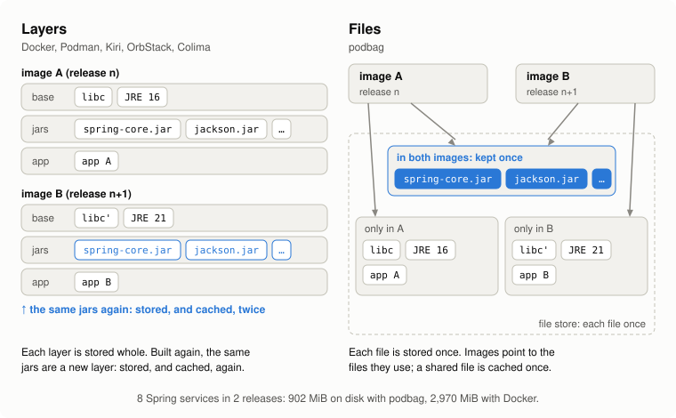
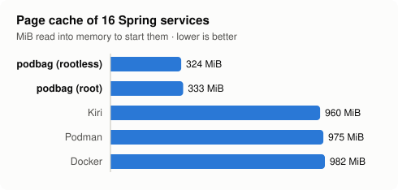

# podbag


A container engine with no daemon, in one static binary.
It stores images file by file: a file that many images share is kept once.
Use the command line or [Podbag Desktop](#podbag-desktop).

[](https://github.com/SteelCrab/podbag/actions/workflows/ci.yml)
[](https://github.com/SteelCrab/podbag/releases/latest)
[](https://crates.io/crates/podbag)
[](LICENSE)
[](https://podbag.dev)

**English** · [한국어](README.ko.md) · [日本語](README.ja.md) · [简体中文](README.zh-CN.md) · [Filipino](README.fil.md) · [Español](README.es.md) · [Tiếng Việt](README.vi.md)


<sub>The same intro as a video: [intro.mp4](docs/media/intro.mp4).</sub>

## Contents

- [Features](#features)
- [Podbag Desktop](#podbag-desktop)
- [Install](#install)
- [Use](#use)
- [Benchmarks](#benchmarks)
- [Compared with other tools](#compared-with-other-tools)
- [Documentation](#documentation)
- [Contributing](#contributing)
- [License](#license)

## Features

- **File sharing across images.** Identical files in different layers can share both disk space and the Linux page cache.
- **On-demand Linux engine.** One process watches a user’s containers. It exits when the last container stops and the idle timeout expires.
- **Automatic VM shutdown on macOS.** The Linux VM shuts down after 60 idle seconds by default. The next container command starts it again.
- **Kubernetes node runtime (`v0.2.0`).** On Linux, `podbag cri serve` lets the kubelet run pods directly with Podbag.
- **Migration between engines (`v0.2.0`).** Copy images, volumes and stopped containers between Docker-compatible engines. The source stays in place.

<picture><source media="(max-width: 600px) and (prefers-color-scheme: dark)" srcset="docs/images/storage-tall-dark.svg"><source media="(max-width: 600px)" srcset="docs/images/storage-tall-light.svg"><source media="(prefers-color-scheme: dark)" srcset="docs/images/storage-dark.svg"></picture>

## Podbag Desktop

Manage containers, images, volumes and networks on Linux and macOS. Windows support is experimental and requires WSL 2. Start, stop or restart a container from the list. Open it to follow its logs.


[Install Podbag Desktop](#install) or [build it from source](docs/usage.md#build-the-desktop-app).

## Install

### Podbag Desktop (recommended)

Get the package for your system from the [latest release](https://github.com/SteelCrab/podbag/releases/latest).

- **Linux (x86_64, arm64).** Install the `.deb` on Debian or Ubuntu, or the `.rpm` on Fedora. The package includes the engine.
- **macOS (Apple silicon, Intel).** Install the CLI with the command below. Extract `podbag-desktop-aarch64-macos.zip` (Apple silicon) or `podbag-desktop-x86_64-macos.zip` (Intel) and open `podbag.app`.
- **Windows (x86_64, ARM64, experimental).** Run the `.msi` for your CPU. If the release has no MSI, get it from a successful [CI run](https://github.com/SteelCrab/podbag/actions/workflows/ci.yml?query=branch%3Amain). Enable WSL 2 to run containers.

### CLI on Linux (x86_64, arm64) and macOS (Apple silicon, Intel)

```sh
curl -fsSL https://podbag.dev/install.sh | sh
podbag --version
```

The installer checks the release’s SHA-256 checksum and installs the CLI in `/usr/local/bin`. Run it again to update.

Linux needs kernel 5.12 or later and cgroup v2. Run `podbag check` to see which prerequisites are missing. For rootless bridge networking, check the `uidmap` and `passt` packages. [Linux requirements](docs/usage.md#requirements-on-linux)

For a manual installation, download the binary for your OS and CPU and verify it against `SHA256SUMS`. [Release downloads](https://github.com/SteelCrab/podbag/releases/latest)

### CLI on Windows (experimental)

Enable WSL 2 with `wsl --install` in an administrator PowerShell window and restart Windows. Download `podbag-x86_64-windows.exe` or `podbag-aarch64-windows.exe` for your CPU. Compare its SHA-256 hash with `SHA256SUMS`, then rename it to `podbag.exe`. [Release downloads](https://github.com/SteelCrab/podbag/releases/latest)

```powershell
.\podbag.exe run --rm alpine echo hello
```

### Other installation options

- **Cargo on Linux.** Run `cargo install --locked podbag` to install the published CLI.
- **Build from source.** Build the CLI and Podbag Desktop with Rust. [Build guide](docs/build.md)

## Use

### Run a container

This prints `hello` and removes the container when it exits.

```sh
podbag run --rm alpine echo hello
```

Run nginx on port 8080, send a request and check the access log.

```sh
podbag run -d --name web -p 8080:80 nginx:alpine
podbag ps
curl -I http://localhost:8080/
podbag logs web
podbag exec web nginx -v
podbag stop web && podbag rm web
```

### Docker CLI and Compose

Linux with a non-root user and `XDG_RUNTIME_DIR` set

```sh
podbag system service &
podbag_socket="unix://$XDG_RUNTIME_DIR/podbag/docker.sock"
```

macOS

```sh
podbag vm start
podbag_socket="unix://$HOME/.podbag/run/docker.sock"
```

Once the socket is set, run these commands from a project whose `compose.yaml` uses published images.

```sh
docker --host "$podbag_socket" ps
docker --host "$podbag_socket" compose up -d
docker --host "$podbag_socket" compose down
```

### Copy an image from Docker (`v0.2.0`)

Start both engines. If Docker has a local `alpine:latest` image, copy it into Podbag with Podbag CLI v0.2.0 or later.

```sh
podbag migrate --from docker --to podbag image alpine:latest
```

[Migration guide](docs/usage.md#migrate-between-engines-or-kubernetes-clusters) · [Command reference](docs/usage.md)

## Benchmarks


<sub>The same comparison as a video: [perf.mp4](docs/media/perf.mp4).</sub>

<table>
<tr>
<td><picture><source media="(prefers-color-scheme: dark)" srcset="docs/images/start-dark.svg"></picture></td>
<td><picture><source media="(prefers-color-scheme: dark)" srcset="docs/images/memory-dark.svg"></picture></td>
</tr>
<tr>
<td><picture><source media="(prefers-color-scheme: dark)" srcset="docs/images/disk-dark.svg"></picture></td>
<td><picture><source media="(prefers-color-scheme: dark)" srcset="docs/images/cache-dark.svg"></picture></td>
</tr>
</table>

- Medians on one Linux VM: 4 CPUs, 3.8 GiB, arm64.
- Versions: podbag 0.1.0, Podman 5.7.0, Docker 29.1.3, Kiri 0.2.1.
- All numbers and how they were measured: [docs/benchmarks.md](docs/benchmarks.md) and
  [docs/benchmarks-msa.md](docs/benchmarks-msa.md).
- As a Kubernetes node's runtime under k3s, with 30 pods: 2 processes in 3.5 MiB, against
  containerd's 63 (276 MiB) and CRI-O's 32 (85 MiB): [docs/benchmarks-k8s.md](docs/benchmarks-k8s.md).

## Compared with other tools

| | podbag | Docker | OrbStack | Colima | Kiri |
|---|---|---|---|---|---|
| Runs on | Linux, macOS, Windows¹ | Linux; macOS and Windows with Docker Desktop | macOS | macOS, Linux | Linux, macOS, Windows |
| Runs in the background | nothing once the last container ends (Mac: a 2 MiB standby) | `dockerd`, `containerd`, a shim per container | a Linux VM with Docker Engine | a Lima VM with Docker or containerd | a daemon; on macOS and Windows a small VM |
| Image storage | files, each kept once | layers | layers | layers | layers, unpacked when first used |
| Mac: `docker run` start, median² | 14.4 ms | 97.4 ms | 90.4 ms | 73.6 ms | 11.8 ms |
| Mac: memory 6 minutes after the last container² | 1.7 MiB | 950 MiB | 795 MiB | 1.54 GiB | 12 MiB |
| License | Apache-2.0 | Apache-2.0; Docker Desktop is paid for larger companies | proprietary | MIT | Apache-2.0 |

¹ Experimental. ² Measured on one Mac, with Docker Desktop for Docker:
[docs/benchmarks.md](docs/benchmarks.md).

<picture><source media="(prefers-color-scheme: dark)" srcset="docs/images/architecture-dark.svg"></picture>

- How the parts fit, and where podbag is still behind: [docs/architecture.md](docs/architecture.md).

## Documentation

- [Usage](docs/usage.md): commands, volumes, networks, limits, Docker API, TUI and GUI, macOS, Windows.
- [Architecture](docs/architecture.md): how podbag differs from Docker.
- [Build from source](docs/build.md): Linux, macOS, Windows.
- [Benchmarks](docs/benchmarks.md) and the [Spring microservices benchmark](docs/benchmarks-msa.md).

## Contributing

- Issues and pull requests are welcome.
- See [CONTRIBUTING.md](CONTRIBUTING.md).

## License

[Apache License 2.0](LICENSE)
