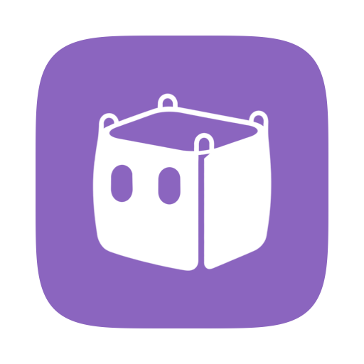

# podbag



Một container engine không có daemon, chỉ gồm một tệp nhị phân tĩnh.
Image được lưu theo từng tệp: tệp mà nhiều image dùng chung chỉ được lưu một lần.

[](https://github.com/SteelCrab/podbag/actions/workflows/ci.yml)
[](https://github.com/SteelCrab/podbag/releases/latest)
[](https://crates.io/crates/podbag)
[](LICENSE)
[](https://podbag.dev)

[English](README.md) · [한국어](README.ko.md) · [日本語](README.ja.md) · [简体中文](README.zh-CN.md) · [Filipino](README.fil.md) · [Español](README.es.md) · **Tiếng Việt**


<sub>Phần giới thiệu này cũng có dạng video (tiếng Anh): [intro.mp4](docs/media/intro.mp4).</sub>

## Mục lục

- [Tính năng](#tính-năng)
- [Cài đặt](#cài-đặt)
- [Sử dụng](#sử-dụng)
- [Đo hiệu năng](#đo-hiệu-năng)
- [So sánh với các công cụ khác](#so-sánh-với-các-công-cụ-khác)
- [Tài liệu](#tài-liệu)
- [Đóng góp](#đóng-góp)
- [Giấy phép](#giấy-phép)

## Tính năng

- **Không có daemon.** Khi không có container nào, không có gì chạy.
- **Một tệp nhị phân tĩnh.** Khoảng 4 MB trên Linux.
- **Theo tệp, không theo lớp.** Tệp mà nhiều image dùng chung chỉ được lưu và cache một lần.
- **Nhanh.** Trên Linux, container khởi động trong khoảng 4 ms.
- **Dùng được với công cụ của Docker.** Image Docker và OCI, CLI `docker`, Compose và buildx.
- **Có hoặc không có root.** Cùng một chương trình chạy được theo cả hai cách.
- **Linux, macOS và Windows.** x86_64 và arm64. Hỗ trợ Windows đang ở giai đoạn thử nghiệm.

### Lớp và tệp

<picture><source media="(max-width: 600px) and (prefers-color-scheme: dark)" srcset="docs/images/storage-vi-tall-dark.svg"><source media="(max-width: 600px)" srcset="docs/images/storage-vi-tall-light.svg"><source media="(prefers-color-scheme: dark)" srcset="docs/images/storage-vi-dark.svg"></picture>

- Kho lưu theo lớp (Docker, Podman, Kiri) chỉ lưu một lớp một lần khi cả lớp giống hệt. Chỉ cần một tệp khác, cả lớp được lưu lại, cùng với các tệp giống với lớp khác.
- podbag lưu mỗi tệp một lần. Một image là danh sách đường dẫn trỏ tới các tệp đó.
- Với 8 dịch vụ Spring ở 2 bản phát hành: 902 MiB đĩa so với 2.970 MiB của Docker, và 324 MiB page cache so với 982 MiB.

## Cài đặt

### Script cài đặt (Linux và macOS)

```sh
curl -fsSL https://podbag.dev/install.sh | sh
```

- Tải tệp phù hợp với hệ thống của bạn và kiểm tra SHA-256.
- Cài vào `/usr/local/bin`, dùng `sudo` khi cần.
- Trên Ubuntu 24.04 trở lên, thêm hồ sơ AppArmor mà container không cần root cần có.
- Tùy chọn: `PODBAG_VERSION=v0.1.0`, `PODBAG_INSTALL_DIR=$HOME/.local/bin`,
  `PODBAG_SKIP_APPARMOR=1`.

### Tải về

Tải tệp từ [bản phát hành mới nhất](https://github.com/SteelCrab/podbag/releases/latest). Kiểm tra bằng `SHA256SUMS`.

| Hệ thống | Tệp |
|---|---|
| Linux, x86_64 | `podbag-x86_64-linux` |
| Linux, arm64 | `podbag-aarch64-linux` |
| macOS, Apple silicon | `podbag-aarch64-macos` |
| Windows, x86_64 (thử nghiệm) | `podbag-x86_64-windows.exe` |
| Windows, arm64 (thử nghiệm) | `podbag-aarch64-windows.exe` |

Windows cần WSL 2 (chạy `wsl --install` một lần):

```powershell
curl.exe -fsSLo podbag.exe https://github.com/SteelCrab/podbag/releases/latest/download/podbag-x86_64-windows.exe
.\podbag.exe run --rm alpine echo hello
```

### Cargo

```sh
cargo install podbag
```

- Dành cho Linux. Trên macOS và Windows, hãy dùng các tệp phát hành: chúng có sẵn VM và Linux engine.

### Biên dịch từ mã nguồn

- Xem [docs/build.md](docs/build.md) cho Linux, macOS và Windows (tiếng Anh).

### Yêu cầu và AppArmor (Linux)

- Linux 5.12 trở lên, có cgroup v2.
- Khi không dùng root, podbag còn cần:
  - `newuidmap` (gói `uidmap`),
  - `pasta` (gói `passt`) cho mạng,
  - một hồ sơ AppArmor trên Ubuntu 24.04 trở lên. Script cài đặt sẽ thêm nó. Làm thủ công:

    ```sh
    podbag check --apparmor-profile | sudo tee /etc/apparmor.d/podbag >/dev/null
    sudo apparmor_parser -r /etc/apparmor.d/podbag
    ```

- `podbag check` cho biết hệ thống của bạn còn thiếu gì và cách thêm vào.

## Sử dụng

### Lệnh cơ bản

```sh
podbag run --rm alpine echo hello                 # tải image nếu cần, chạy rồi xóa
podbag run -d --name web -p 8080:80 nginx:alpine  # chạy ở chế độ nền
podbag ps                                         # liệt kê container
podbag logs -f web                                # theo dõi log
podbag exec -it web sh                            # mở shell trong container
podbag stop web && podbag rm web                  # dừng và xóa
podbag images                                     # liệt kê image
podbag login ghcr.io                              # đăng nhập registry (dùng chung với docker login)
podbag push ghcr.io/me/app:1                      # gửi image lên registry
```

### CLI docker, Compose và buildx

```sh
podbag system service &      # Linux (trên macOS: podbag vm start)
export DOCKER_HOST=unix://$XDG_RUNTIME_DIR/podbag/docker.sock   # macOS: unix://$HOME/.podbag/run/docker.sock
docker compose up -d
```

- Tất cả lệnh và tùy chọn: [docs/usage.md](docs/usage.md) (tiếng Anh).

## Đo hiệu năng


<sub>Cùng phép so sánh dưới dạng video (tiếng Anh): [perf.mp4](docs/media/perf.mp4).</sub>

<table>
<tr>
<td><picture><source media="(prefers-color-scheme: dark)" srcset="docs/images/start-dark.svg"></picture></td>
<td><picture><source media="(prefers-color-scheme: dark)" srcset="docs/images/memory-dark.svg"></picture></td>
</tr>
<tr>
<td><picture><source media="(prefers-color-scheme: dark)" srcset="docs/images/disk-dark.svg"></picture></td>
<td><picture><source media="(prefers-color-scheme: dark)" srcset="docs/images/cache-dark.svg"></picture></td>
</tr>
</table>

- Giá trị trung vị trên một máy ảo Linux: 4 CPU, 3.8 GiB, arm64.
- Phiên bản: podbag 0.1.0, Podman 5.7.0, Docker 29.1.3, Kiri 0.2.1.
- Tất cả số liệu và cách đo: [docs/benchmarks.md](docs/benchmarks.md) và [docs/benchmarks-msa.md](docs/benchmarks-msa.md) (tiếng Anh).

## So sánh với các công cụ khác

| | podbag | Docker | OrbStack | Colima | Kiri |
|---|---|---|---|---|---|
| Chạy trên | Linux, macOS, Windows¹ | Linux; macOS và Windows dùng Docker Desktop | macOS | macOS, Linux | Linux, macOS, Windows |
| Chạy nền | không có gì khi container cuối cùng kết thúc (Mac: một tiến trình chờ 2 MiB) | `dockerd`, `containerd`, mỗi container một shim | một máy ảo Linux có Docker Engine | một máy ảo Lima có Docker hoặc containerd | một daemon; trên macOS và Windows là một máy ảo nhỏ |
| Lưu image | theo tệp, mỗi tệp một lần | theo lớp | theo lớp | theo lớp | theo lớp, giải nén ở lần dùng đầu |
| Mac: khởi động bằng `docker run`, trung vị² | 14.4 ms | 97.4 ms | 90.4 ms | 73.6 ms | 11.8 ms |
| Mac: bộ nhớ 6 phút sau container cuối cùng² | 1.7 MiB | 950 MiB | 795 MiB | 1.54 GiB | 12 MiB |
| Giấy phép | Apache-2.0 | Apache-2.0; Docker Desktop tính phí với công ty lớn | độc quyền | MIT | Apache-2.0 |

¹ Thử nghiệm. ² Đo trên một máy Mac, Docker là Docker Desktop: [docs/benchmarks.md](docs/benchmarks.md).

<picture><source media="(prefers-color-scheme: dark)" srcset="docs/images/architecture-dark.svg"></picture>

- Các phần ăn khớp với nhau thế nào, và podbag còn kém ở đâu: [docs/architecture.md](docs/architecture.md) (tiếng Anh).

## Tài liệu

Các tài liệu dưới đây bằng tiếng Anh.

- [Sử dụng](docs/usage.md): lệnh, volume, mạng, giới hạn, Docker API, macOS, Windows.
- [Kiến trúc](docs/architecture.md): podbag khác Docker thế nào.
- [Biên dịch từ mã nguồn](docs/build.md): Linux, macOS, Windows.
- [Đo hiệu năng](docs/benchmarks.md) và [bài đo với microservice Spring](docs/benchmarks-msa.md).

## Đóng góp

- Chúng tôi hoan nghênh issue và pull request.
- Xem [CONTRIBUTING.md](CONTRIBUTING.md) (tiếng Anh).

## Giấy phép

[Apache License 2.0](LICENSE)
