# podbag


没有守护进程的容器引擎，只是一个静态二进制文件。
镜像按文件存储：多个镜像共用的文件只保存一份。

[](https://github.com/SteelCrab/podbag/actions/workflows/ci.yml)
[](https://github.com/SteelCrab/podbag/releases/latest)
[](https://crates.io/crates/podbag)
[](LICENSE)
[](https://podbag.dev)

[English](README.md) · [한국어](README.ko.md) · [日本語](README.ja.md) · **简体中文** · [Filipino](README.fil.md) · [Español](README.es.md) · [Tiếng Việt](README.vi.md)


<sub>同样的介绍也有视频版（英文）: [intro.mp4](docs/media/intro.mp4).</sub>

## 目录

- [特性](#特性)
- [安装](#安装)
- [使用](#使用)
- [基准测试](#基准测试)
- [与其他工具比较](#与其他工具比较)
- [文档](#文档)
- [参与贡献](#参与贡献)
- [许可证](#许可证)

## 特性

- **没有守护进程。** 没有容器时，什么都不运行。
- **一个静态二进制文件。** 在 Linux 上约 4 MB。
- **按文件，而不是按层。** 多个镜像共用的文件，在磁盘和内存中只保存一份。
- **快。** 在 Linux 上，容器约 4 毫秒启动。
- **兼容 Docker 工具。** 支持 Docker 和 OCI 镜像、`docker` CLI、Compose 和 buildx。
- **构建 Dockerfile。** 可以用 `podbag build`，也可以用经典构建器的 `docker build`，不需要 BuildKit 或守护进程。
- **有无 root 都可以。** 同一个程序两种方式都能用。
- **Linux、macOS 和 Windows。** 支持 x86_64 和 arm64。Windows 支持处于实验阶段。
- **有 TUI 和桌面应用。** 在终端里用 `podbag tui`，在桌面上用带菜单栏图标的窗口，管理容器、镜像、卷和网络。

### 层与文件

<picture><source media="(max-width: 600px) and (prefers-color-scheme: dark)" srcset="docs/images/storage-zh-CN-tall-dark.svg"><source media="(max-width: 600px)" srcset="docs/images/storage-zh-CN-tall-light.svg"><source media="(prefers-color-scheme: dark)" srcset="docs/images/storage-zh-CN-dark.svg"></picture>

- 按层存储（Docker、Podman、Kiri）只有在整层完全相同时才只存一份。只要有一个文件不同，整层就要再存一次，和其他层相同的文件也跟着再存一次。
- podbag 每个文件只保存一份。镜像是指向这些文件的路径列表。
- 以 8 个 Spring 服务、2 个版本为例：磁盘 902 MiB（Docker 为 2,970 MiB），页缓存 324 MiB（Docker 为 982 MiB）。

## 安装

### 安装脚本（Linux、macOS）

```sh
curl -fsSL https://podbag.dev/install.sh | sh
```

- 下载适合你系统的文件，并校验 SHA-256。
- 安装到 `/usr/local/bin`，需要时使用 `sudo`。
- 在 Ubuntu 24.04 及以上版本，添加 rootless 容器需要的 AppArmor 配置文件。
- 设置： `PODBAG_VERSION=v0.1.0`, `PODBAG_INSTALL_DIR=$HOME/.local/bin`,
  `PODBAG_SKIP_APPARMOR=1`.

### 下载

从[最新版本](https://github.com/SteelCrab/podbag/releases/latest)下载文件，并用 `SHA256SUMS` 校验。

| 系统 | 文件 |
|---|---|
| Linux，x86_64 | `podbag-x86_64-linux` |
| Linux，arm64 | `podbag-aarch64-linux` |
| macOS，Apple 芯片 | `podbag-aarch64-macos` |
| Windows，x86_64（实验） | `podbag-x86_64-windows.exe` |
| Windows，arm64（实验） | `podbag-aarch64-windows.exe` |

Windows 需要 WSL 2（运行一次 `wsl --install`）：

```powershell
curl.exe -fsSLo podbag.exe https://github.com/SteelCrab/podbag/releases/latest/download/podbag-x86_64-windows.exe
.\podbag.exe run --rm alpine echo hello
```

### Cargo

```sh
cargo install podbag
```

- 仅适用于 Linux。在 macOS 和 Windows 上请使用发布文件：其中包含虚拟机和 Linux 引擎。

### 从源码构建

- Linux、macOS 和 Windows 的构建方法见 [docs/build.md](docs/build.md)（英文）。

### 系统要求和 AppArmor（Linux）

- Linux 5.12 或更高版本，cgroup v2。
- 不使用 root 时，还需要：
  - `newuidmap`（软件包 `uidmap`），
  - 用于网络的 `pasta`（软件包 `passt`），
  - 在 Ubuntu 24.04 及以上版本，需要 AppArmor 配置文件。安装脚本会添加它。手动添加：

    ```sh
    podbag check --apparmor-profile | sudo tee /etc/apparmor.d/podbag >/dev/null
    sudo apparmor_parser -r /etc/apparmor.d/podbag
    ```

- `podbag check` 会列出系统还缺少什么，以及如何添加。

## 使用

### 基本命令

```sh
podbag run --rm alpine echo hello                 # 需要时拉取镜像，运行，然后删除
podbag run -d --name web -p 8080:80 nginx:alpine  # 在后台运行
podbag ps                                         # 列出容器
podbag logs -f web                                # 持续查看日志
podbag exec -it web sh                            # 在容器里打开 shell
podbag stop web && podbag rm web                  # 停止并删除
podbag images                                     # 列出镜像
podbag build -t myapp .                           # 用 Dockerfile 构建镜像
```

### docker CLI、Compose 和 buildx

```sh
podbag system service &      # Linux（macOS：podbag vm start）
export DOCKER_HOST=unix://$XDG_RUNTIME_DIR/podbag/docker.sock   # macOS：unix://$HOME/.podbag/run/docker.sock
docker compose up -d
```

- 所有命令和选项：[docs/usage.md](docs/usage.md)（英文）。

## 基准测试


<sub>同样的比较，视频版（英文）: [perf.mp4](docs/media/perf.mp4).</sub>

<table>
<tr>
<td><picture><source media="(prefers-color-scheme: dark)" srcset="docs/images/start-dark.svg"></picture></td>
<td><picture><source media="(prefers-color-scheme: dark)" srcset="docs/images/memory-dark.svg"></picture></td>
</tr>
<tr>
<td><picture><source media="(prefers-color-scheme: dark)" srcset="docs/images/disk-dark.svg"></picture></td>
<td><picture><source media="(prefers-color-scheme: dark)" srcset="docs/images/cache-dark.svg"></picture></td>
</tr>
</table>

- 在一台 Linux 虚拟机上测得的中位数：4 个 CPU，3.8 GiB，arm64。
- 版本：podbag 0.1.0，Podman 5.7.0，Docker 29.1.3，Kiri 0.2.1。
- 所有数据和测量方法：[docs/benchmarks.md](docs/benchmarks.md)、[docs/benchmarks-msa.md](docs/benchmarks-msa.md)（英文）。

## 与其他工具比较

| | podbag | Docker | OrbStack | Colima | Kiri |
|---|---|---|---|---|---|
| 运行平台 | Linux、macOS、Windows¹ | Linux；macOS 和 Windows 用 Docker Desktop | macOS | macOS、Linux | Linux、macOS、Windows |
| 后台运行的进程 | 最后一个容器结束后无（Mac：2 MiB 的待机进程） | `dockerd`、`containerd`，每个容器一个 shim | 带 Docker Engine 的 Linux 虚拟机 | 带 Docker 或 containerd 的 Lima 虚拟机 | 一个守护进程；在 macOS 和 Windows 上还有一个小虚拟机 |
| 镜像存储 | 文件，每个只存一份 | 层 | 层 | 层 | 层，首次使用时解压 |
| Mac：`docker run` 启动，中位数² | 14.4 ms | 97.4 ms | 90.4 ms | 73.6 ms | 11.8 ms |
| Mac：最后一个容器结束 6 分钟后的内存² | 1.7 MiB | 950 MiB | 795 MiB | 1.54 GiB | 12 MiB |
| 许可证 | Apache-2.0 | Apache-2.0；Docker Desktop 对较大公司收费 | 专有 | MIT | Apache-2.0 |

¹ 实验阶段。² 在一台 Mac 上测得，Docker 为 Docker Desktop：[docs/benchmarks.md](docs/benchmarks.md)。

<picture><source media="(prefers-color-scheme: dark)" srcset="docs/images/architecture-dark.svg"></picture>

- 各部分如何配合，以及 podbag 目前的不足：[docs/architecture.md](docs/architecture.md)（英文）。

## 文档

以下文档为英文。

- [使用](docs/usage.md)：命令、卷、网络、限制、Docker API、TUI 和 GUI、macOS、Windows。
- [架构](docs/architecture.md)：podbag 与 Docker 的区别。
- [从源码构建](docs/build.md)：Linux、macOS、Windows。
- [基准测试](docs/benchmarks.md)和 [Spring 微服务基准测试](docs/benchmarks-msa.md)。

## 参与贡献

- 欢迎提交 issue 和 pull request。
- 请参阅 [CONTRIBUTING.md](CONTRIBUTING.md)（英文）。

## 许可证

[Apache License 2.0](LICENSE)
