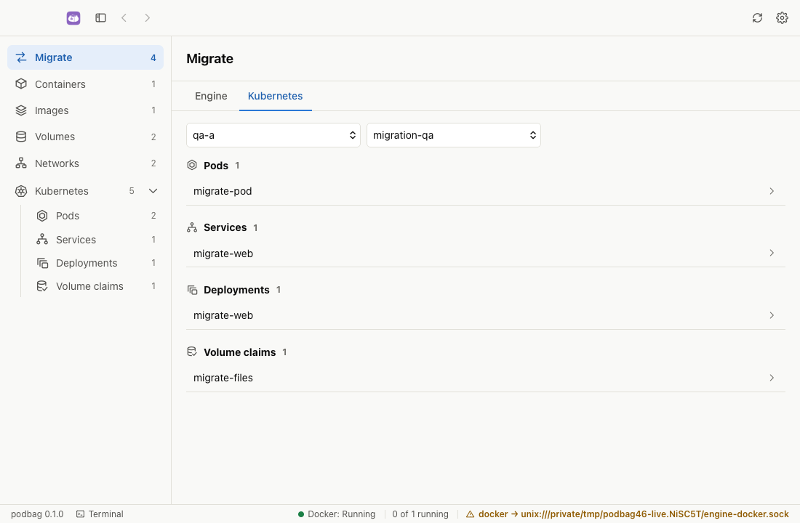

# Using podbag

The [README](../README.md) shows how to install podbag. This page shows what it can do.

## Contents

- [Commands](#commands)
- [How containers run](#how-containers-run)
  - [No daemon](#no-daemon)
  - [The keeper](#the-keeper)
  - [Isolation](#isolation)
  - [Restart policies](#restart-policies)
  - [Health checks](#health-checks)
- [Images](#images)
  - [Storage](#storage)
  - [How a container sees its image](#how-a-container-sees-its-image)
  - [File times and links](#file-times-and-links)
  - [Damaged files](#damaged-files)
  - [Choose the method](#choose-the-method)
  - [Compression](#compression)
- [Registries](#registries)
  - [Log in and out](#log-in-and-out)
  - [Pull and push](#pull-and-push)
  - [How a push works](#how-a-push-works)
- [Builds](#builds)
  - [Build an image](#build-an-image)
  - [How the steps work](#how-the-steps-work)
  - [Dockerfiles](#dockerfiles)
  - [The cache](#the-cache)
  - [commit, export and diff](#commit-export-and-diff)
  - [Not supported in builds](#not-supported-in-builds)
- [Checks](#checks)
  - [podbag check](#podbag-check)
  - [podbag check-image](#podbag-check-image)
  - [Clear errors](#clear-errors)
- [Volumes](#volumes)
- [Limits and security](#limits-and-security)
  - [Options](#options)
  - [Memory budget](#memory-budget)
  - [Where the cgroups are](#where-the-cgroups-are)
  - [Security defaults](#security-defaults)
  - [--privileged](#--privileged)
- [Watch and change containers](#watch-and-change-containers)
  - [stats](#stats)
  - [top](#top)
  - [pause and unpause](#pause-and-unpause)
  - [rename](#rename)
  - [update](#update)
- [Networks](#networks)
  - [Options](#options-1)
  - [Names and addresses](#names-and-addresses)
  - [Extra hosts and DNS](#extra-hosts-and-dns)
  - [host-gateway](#host-gateway)
  - [How it works](#how-it-works)
- [Docker API](#docker-api)
  - [Start it](#start-it)
  - [What works](#what-works)
  - [What does not work](#what-does-not-work)
  - [cp, save and load](#cp-save-and-load)
  - [Differences from Docker](#differences-from-docker)
  - [Docker Compose](#docker-compose)
  - [Builds with the docker CLI](#builds-with-the-docker-cli)
  - [buildx](#buildx)
- [TUI and GUI](#tui-and-gui)
  - [Which engine they use](#which-engine-they-use)
  - [Migrate between engines or Kubernetes clusters](#migrate-between-engines-or-kubernetes-clusters)
  - [Dashboard operations from the CLI](#dashboard-operations-from-the-cli)
  - [podbag tui](#podbag-tui)
  - [podbag-desktop](#podbag-desktop)
  - [Build the desktop app](#build-the-desktop-app)
  - [What is hidden](#what-is-hidden)
- [Swarm mode](#swarm-mode)
  - [Enroll a worker](#enroll-a-worker)
  - [Distribute replicas across workers](#distribute-replicas-across-workers)
  - [What it is](#what-it-is)
  - [How it runs without a daemon](#how-it-runs-without-a-daemon)
  - [Networks and ports](#networks-and-ports)
  - [Secrets and configs](#secrets-and-configs)
  - [What does not work](#what-does-not-work-1)
- [Kubernetes](#kubernetes)
  - [Start it](#start-it-1)
  - [How pods run](#how-pods-run)
  - [What works](#what-works-1)
  - [What does not work](#what-does-not-work-2)
- [macOS](#macos)
  - [The VM](#the-vm)
  - [Commands and files](#commands-and-files)
  - [Registry logins](#registry-logins)
  - [Resources](#resources)
  - [docker CLI, Compose and buildx](#docker-cli-compose-and-buildx)
  - [Ports, disk and memory](#ports-disk-and-memory)
  - [Build it yourself](#build-it-yourself)
- [Windows (experimental)](#windows-experimental)
  - [Setup](#setup)
  - [How it works](#how-it-works-1)
  - [Limits](#limits)
- [Update podbag](#update-podbag)
  - [How it works](#how-it-works-2)
  - [Where podbag is installed](#where-podbag-is-installed)
  - [After the update](#after-the-update)
  - [Limits](#limits-1)
- [Requirements on Linux](#requirements-on-linux)
- [AppArmor](#apparmor)

## Commands

```sh
podbag run alpine echo hello                 # pull the image if needed; the container stays
podbag run --rm -it alpine sh                # an interactive shell, removed when it ends
podbag run -d --name web nginx:alpine        # in the background
podbag run -d --restart on-failure:3 myjob   # start again when it fails
podbag run -m 512m --cpus 1.5 --pids-limit 200 alpine sh                  # limits
podbag run -v ./src:/work:ro -v pgdata:/var/lib/pg --tmpfs /run alpine sh # volumes
podbag volume create|ls|rm|inspect
podbag network create app                    # a network
podbag run -d --name db --network app alpine sleep 1d
podbag run -d --name api --network app -p 8080:80 nginx:alpine
podbag exec api ping -c1 db                  # containers find each other by name
podbag ps -a
podbag logs -f web
podbag exec -it web sh
podbag stats --no-stream                     # CPU, memory, network and disk use
podbag top web                               # the container's processes
podbag pause web && podbag unpause web       # freeze and continue
podbag rename web front                      # a new name, also while it runs
podbag update -m 1g --restart always front   # new limits, at once and for later starts
podbag stop web && podbag rm web
podbag pull alpine | podbag images | podbag rmi alpine
podbag save -o app.tar myapp:1 && podbag load -i app.tar   # image archives
podbag login ghcr.io                         # log in to a registry (shared with docker login)
podbag tag myapp:1 ghcr.io/me/myapp:1 && podbag push ghcr.io/me/myapp:1
podbag search nginx                          # search Docker Hub
podbag build -t myapp:1 .                    # build an image from ./Dockerfile
podbag commit web web-snapshot:1             # a container's changes as an image
podbag diff web                              # the files a container changed
podbag export -o web.tar web                 # all its files as a tar
podbag run --rm --privileged alpine mount -t tmpfs none /mnt
podbag system df | podbag system prune -f
podbag system verify                         # check every stored file (exit code 1 if one is damaged)
podbag system compression idle               # turn on image compression (see Compression)
podbag system compress                       # compress images idle for 7 days (default; see Compression)
podbag system decompress myapp:1             # decompress an image now
podbag run --rootfs ./rootfs sh              # a plain folder instead of an image
podbag check                                 # is this system ready? (exit code 1 if not)
podbag check-image myapp:1                   # programs that cannot run in the image
podbag system service &                      # the Docker API, for the docker CLI
podbag vm status                             # macOS and Windows: podbag's Linux VM
podbag tui                                   # containers, images, volumes and networks
podbag migrate --from docker --to podbag image myapp:1   # copy between engines
podbag engine list container                 # dashboard operations, as JSON
podbag kube list pod --context dev           # Kubernetes resources, with kubectl
podbag tutorial status                       # the volume and HTTP tutorial
podbag system docker use                     # point the docker command at podbag
podbag upgrade                               # install the latest release
```

## How containers run

### No daemon

- podbag has no daemon.
- One small **keeper** process (about 2 MiB) watches the containers in the background:
  - it writes their logs,
  - it answers `stop`, `kill` and `wait` for them.
- The keeper starts with the first container. It stops 10 seconds after the last one.
- With no container, nothing runs.
- A container in the foreground, or one that publishes ports, has a small helper process
  of its own while it runs.

### The keeper

- The keeper is the parent of its containers. If it is killed, they stop too.
- It serves only the user who started it.
- After an upgrade, new containers get their own helper until the old keeper stops.
- Turn it off with `keeper = false` in `config.toml`, or `PODBAG_KEEPER=0`. Then each
  container gets its own `podbag __shim` process.
- `keeper_linger = 10000` (milliseconds) sets how long an idle keeper stays.

### Isolation

- Each container gets new mount, PID, UTS, IPC and cgroup namespaces.
- Without root, it also gets a user namespace.

### Restart policies

- Use `--restart no|always|unless-stopped|on-failure[:N]`.
- No daemon is needed. When a container stops, a small `podbag __restart` process starts
  it again.
- The wait before a restart is 100 ms, then twice as long each time, up to 1 minute.
  After a run of 10 seconds, it is 100 ms again.
- `stop` and `kill` end the restarts until the next `start`.
- `--rm` does not go with a restart policy.
- Nothing starts containers when the machine starts, so `always` and `unless-stopped`
  work the same.
- `inspect` shows the restarts since the last `start`.

### Health checks

- Use `--health-cmd`, `--health-interval`, `--health-timeout`, `--health-retries`,
  `--health-start-period` and `--health-start-interval`. An image's `HEALTHCHECK` works too.
- No process runs between checks. When a check is due, the keeper (or the container's
  helper) starts `podbag __health`.
- `podbag __health` runs the check, keeps the last five results, and stops.
- A check that runs past its timeout is stopped.
- `ps` and `inspect` show the health: `starting`, `healthy` or `unhealthy`.
- `--no-healthcheck` turns the image's check off.
- Images pulled with an older podbag get their check at the next pull.

## Images

### Storage

- Each distinct file is stored once, whatever image it comes from.
- Identical files in different images share the page cache (memory). In hard-link trees
  (without root) they must have the same time too: see [File times and links](#file-times-and-links).
- The store keeps at most 10 GiB by default.

### How a container sees its image

- **composefs** (as root, Linux 6.5 or later):
  - each image has a small metadata file (EROFS) that lists its files,
  - podbag mounts it once; all containers of the image share that mount,
  - a pull does not unpack a folder tree.
- **Hard-link trees** (without root, or on older kernels):
  - each image is unpacked once, as a folder of hard links to the stored files.
- Both ways show the same files, owners, modes, times, extended attributes and hard links.

### File times and links

- Files keep the times they have in the image:
  - Python's `.pyc` files stay valid, so containers do not compile them again,
  - nginx sends the same `ETag` and `Last-Modified` headers as with Docker.
- In a hard-link tree, files share one inode only when their times match too. A file
  with the contents of another but a different time gets a copy of its own. A rebuilt
  image whose files got new times shares less with the old one.
- Crontabs (`/etc/crontab`, and everything in `/etc/cron.d` and `/var/spool/cron`) get
  an inode of their own: cron skips a crontab that has more than one link.
- Images stored by podbag 0.1.0 keep the times and links they had. To fix them, remove
  them and pull or load them again.

### Damaged files

- podbag writes new files to disk before it records them. A crash cannot leave an image
  whose files never reached the disk.
- A stored file that a crash cut short is written again by the next pull or load that
  reads a layer with that file. All images that share the file get it back.
- `podbag system verify` reads every stored file and checks its hash:
  - it names the images that use a damaged file, and exits with 1,
  - `--fix` removes those images (not the ones a container uses); then pull or load
    them again.

### Choose the method

- As root, podbag tests composefs once per kernel and remembers the result.
- `podbag check` shows the method in use, and why composefs is not available.
- To use hard-link trees as root too: `image_mount = "hardlink"` in `config.toml`, or
  `PODBAG_IMAGE_MOUNT=hardlink`.
- When the method changes, an image gets what it needs the first time a container uses it.
- Removing an image unmounts it.

### Compression

- podbag can compress images that no container uses. It is off by default.
- It compresses each stored file with zstd (fastest level), file by file:
  - files that two images share stay shared,
  - files smaller than 4096 bytes are not compressed: they would not use fewer disk blocks.
- Example: two python images, two Java images and alpine (725 MB in the store) took
  337 MB after compression.
- Turn it on with `podbag system compression idle`. It works on Linux, macOS and Windows:

```sh
podbag system compression                 # show the setting
podbag system compression idle            # turn it on
podbag system compression idle --after 3d # and compress images unused for 3 days
podbag system compression off             # turn it off
podbag system compression --json          # {"mode":"idle","after":604800}
```

- The command saves `image_compression` and `compress_idle_after` in the engine's
  `config.toml`. Other lines of the file stay as they are.
- On macOS and Windows the setting is kept where the engine runs: in the VM
  (`/var/lib/podbag/config/config.toml`) or in podbag's WSL distribution. A
  `config.toml` on the Mac or in Windows has no effect. Use `podbag system compression`
  or Podbag Desktop (**Settings → Engine → Compress idle images**).
- On Linux you can also edit `config.toml` (`image_compression = "idle"`).
- On Linux and macOS, `PODBAG_IMAGE_COMPRESSION=idle` (or `off`) sets it for one
  command. The environment variable wins over the saved setting.
- An image is idle when no container (also a stopped one) uses it, and it was not used
  for `compress_idle_after`:
  - the default is `"7d"`; other forms are `"36h"`, `"90m"`, `"45s"` and `"0"`,
  - change it with `podbag system compression --after AGE`, `compress_idle_after` in
    `config.toml`, or `PODBAG_COMPRESS_IDLE_AFTER`,
  - the image that a command has just pulled is skipped by that command.
- With `idle`, podbag compresses after `pull`, `load`, `build`, `rmi` and `prune`:
  - one command does at most 256 MiB or 2 seconds of work; the next command goes on,
  - files larger than 32 MiB are left as they are: only `podbag system compress`
    compresses them,
  - when the store is over `store_limit`, podbag compresses before it removes images.
- Compress or decompress at once, whatever the setting:

```sh
podbag system compress                # all idle images
podbag system compress myapp:1 nginx  # these images, whatever their age
podbag system decompress myapp:1      # decompress now: the next container starts at once
```

- `system compress` also compresses files larger than 32 MiB. While it compresses such
  a file, container starts and pulls wait until it is done.
- `system compress` never compresses an image that a container uses:
  - with image names, it prints a message for each such image,
  - without names, it leaves such images out without a message.
- A compressed image is decompressed when a container is created from it, or when a
  build reads it:
  - the first start is slower by the time to decompress the files,
  - measured in a VM on a laptop (4 CPUs, python 146 MB, Java 310 MB): the first
    `podbag run` took 1.4 s for the python image and 1.8 s for the Java image; without
    compression, the same start took 30 ms and 55 ms,
  - the next starts are as fast as before.
- Images that are not compressed start as fast as with the feature off (alpine: the
  same time within 1 ms).
- `podbag system df` has a `Compressed` row: the count of compressed files, and
  `<compressed size> (<size before>)`.
- All sizes (`store_limit`, `system df`, freed bytes of a prune) are bytes on disk, so a
  compressed image counts less.
- `save`, `push` and `podbag system verify` work on compressed images. They read the
  files without decompressing them on disk.
- `dev/bench/compress.sh` measures all of this.

## Registries

### Log in and out

```sh
podbag login                                         # Docker Hub: asks for the user name and password
echo "$TOKEN" | podbag login ghcr.io -u me --password-stdin
podbag logout ghcr.io
```

- podbag checks the login with the registry before it keeps it.
- Logins live where Docker keeps them: `~/.docker/config.json`, or `config.json` in
  `$DOCKER_CONFIG`. `docker login` and `podbag login` share them.
- With `credsStore` or `credHelpers` in that file, a credential helper keeps the password,
  for example in the macOS keychain. The helper is the program `docker-credential-<name>`.
- Without a helper, the file keeps the login in base64. Only you can read the file (mode
  `0600`), but the password is not encrypted.
- When the registry gives a token for the login (an identity token), podbag keeps the
  token, not the password.

### Pull and push

```sh
podbag pull ghcr.io/me/private:1                     # uses the login for ghcr.io
podbag tag myapp:1 localhost:5000/myapp:1
podbag push localhost:5000/myapp:1
podbag search --limit 5 nginx
```

- `pull`, `run` and `create` use the registry's login when there is one.
- Without a login, a private image fails with the command that logs in. A wrong password
  fails with "login failed".
- Registries on `localhost`, `127.0.0.1` or `::1` use plain HTTP, as with Docker. All
  others use HTTPS.
- `search` uses Docker Hub's search. `search localhost:5000/name` asks that registry, if it
  has the same search API.

### How a push works

- The store keeps files, not layer archives. For each layer, a push uses the first of these
  that works:
  - nothing: the repository has the layer already,
  - a mount: the registry copies the layer from another of its repositories, for example
    the base image you pulled from it,
  - an upload: podbag writes the layer again from its files, as `save` does, and compresses
    it with gzip.
- A layer written again gets a new digest. The same files always give the same layer, so a
  second push of the same image sends nothing.
- The image keeps its format: OCI when it came as OCI, else Docker's.
- Each layer goes in one request. podbag does not send layers in chunks.

## Builds

### Build an image

```sh
podbag build -t myapp:1 .                          # ./Dockerfile, with . as the context
podbag build -f app.Dockerfile --build-arg VERSION=2 --target app -t myapp .
tar -c . | podbag build -t myapp -                 # the context as a tar on stdin
podbag build -t myapp - < Dockerfile               # only a Dockerfile, no context
```

- No BuildKit and no daemon: podbag reads the Dockerfile and does each step itself.
- Options: `-t` (more than once), `-f`, `--build-arg`, `--target`, `--no-cache`, `--pull`,
  `--label`, `--network`, `-q`.
- Base images from private registries use your `podbag login`. Through the Docker API,
  podbag uses the logins the docker CLI sends, then your own.

### How the steps work

- `RUN` runs in a podbag container on the image so far, with the build arguments, `ENV`,
  `USER`, `WORKDIR` and `SHELL` of the stage.
  - The network is the default bridge; `--network host|none|<name>` changes it.
  - The files it changed become a new layer. Deleted files stay deleted in the image.
- `COPY` and `ADD` put the files in a new layer, owned by root unless `--chown` says
  otherwise. `--chmod` sets the mode.
  - `ADD` unpacks a local tar archive (plain, gzip or zstd) and downloads a URL.
- `WORKDIR` makes the folder when it is missing.
- Steps that change only settings (`ENV`, `CMD`, `LABEL`, `EXPOSE`, …) make no layer.
- The new layers go into the store like pulled ones: each file is kept once.

### Dockerfiles

- All the classic instructions: `FROM` (`AS`), `RUN`, `CMD`, `ENTRYPOINT`, `ENV`, `ARG`,
  `LABEL`, `EXPOSE`, `VOLUME`, `USER`, `WORKDIR`, `COPY`, `ADD`, `ONBUILD`, `STOPSIGNAL`,
  `HEALTHCHECK`, `SHELL`.
- Variables (`$V`, `${V:-default}`, `${V:+set}`), `ARG` before `FROM`, `# escape=`, line
  continuations, JSON and shell forms, `RUN <<EOF` heredocs.
- Several stages: only the stages the target needs are built. `COPY --from` takes a stage
  name, a stage number or an image.
- `.dockerignore` (or `<Dockerfile>.dockerignore`) leaves files out of the context, with
  Docker's patterns (`**`, `!` exceptions).
- `ARG TARGETARCH` and the other platform arguments have this machine's values.

### The cache

- Each step's result is kept. A step is found again by:
  - the image before it,
  - the instruction, after its variables,
  - the build arguments a `RUN` sees,
  - the contents of the files a `COPY` or `ADD` copies.
- A second build prints `Using cache` for the steps it did not do again.
- `--no-cache` does every step again.
- The steps' images have no name: `podbag system prune` (or `docker image prune`) removes
  them, and the cache entries with them. `docker builder prune` forgets the cache.

### commit, export and diff

- `podbag commit CONTAINER [NAME]`: the container's image plus its changes, as a new image.
  - `-c` sets the config with a Dockerfile instruction: `-c 'CMD ["app"]'`.
  - It works on running containers too, without stopping them.
  - It does not pause a running container (Docker pauses by default), so a file that is
    being written at that moment can be cut.
- `podbag export [-o FILE] CONTAINER`: all its files as a tar, without its volumes.
- `podbag diff CONTAINER`: the paths it changed: `A` added, `C` changed, `D` deleted.

### Not supported in builds

- BuildKit features: `RUN --mount`, secrets, SSH, `--output`, cache export and import,
  builds for other platforms, `COPY --parents` and `--exclude`, `ADD --checksum`, `ADD` of a
  Git repository, heredocs in `COPY` and `ADD`. podbag stops with a message; build such
  Dockerfiles with buildx (see [buildx](#buildx)).
- `ADD` of bzip2 or xz archives.
- Image history (`docker history`).
- Changes that a `RUN` makes in a `VOLUME` path stay in the image (Docker drops them).

## Checks

### podbag check

- Lists what podbag needs on this system, one line each:
  - the kernel and cgroup v2,
  - how images are mounted (as root),
  - the keeper,
  - without root: `newuidmap`/`newgidmap`, subordinate IDs, `pasta`, the systemd user
    session, AppArmor, linger, and the lowest port a user can publish.
- Each problem comes with the command that fixes it.
- As root, it warns when Docker's firewall blocks bridge networks.
- `podbag check --apparmor-profile` prints the AppArmor profile (see [AppArmor](#apparmor)).

### podbag check-image

- `podbag check-image IMAGE` reads every program and library in a pulled image. It does not
  run them.
- It reports what cannot run:
  - programs built for another C library (glibc in a musl image such as Alpine, or the
    reverse),
  - programs built for another CPU,
  - programs that need a library the image does not have (a warning).
- It exits with code 1 when it finds an error, so CI can use it.

### Clear errors

- When a program cannot start for one of these reasons, `run` and `exec` say why, not just
  "no such file". For example:
  - the program needs `/lib/ld-linux-aarch64.so.1` (glibc), and the image does not have it,
  - a script's first line names an interpreter that the image does not have.

## Volumes

| Option | Effect |
|---|---|
| `-v /host/dir:/dir[:ro]`, `-v ./dir:/dir` | a host folder; made if missing, as with `docker run -v` |
| `-v name:/dir[:ro][,nocopy]` | a named volume in `<data>/volumes/<name>/data`, made on first use |
| `-v /dir` | an anonymous volume, removed with the container by `--rm` or `rm -v` |
| `--tmpfs /dir[:size=64m,mode=1777,…]` | a file system in memory (`nosuid,nodev,noexec` unless asked) |

- The first time an empty volume is mounted, it gets the image's files at its target (with
  their owners and modes). `nocopy` turns this off.
- An image's `Volumes` become anonymous volumes.
- `podbag volume rm` refuses a volume that a container still names.
- Mount targets are found inside the container's root. A symbolic link in the image cannot
  send a mount outside it.
- `/proc` and `/sys` cannot hold mounts.

## Limits and security

### Options

| Option | Effect |
|---|---|
| `-m, --memory 512m` | `memory.max` (and as much swap); at least 6 MiB |
| `--cpus 0.5` | `cpu.max`; at least 0.01 |
| `--pids-limit 100` | `pids.max`; 0 or less means no limit |
| `--cap-add NAME`, `--cap-drop NAME` | change Docker's 14 default capabilities (`ALL` works; drops first) |
| `--security-opt no-new-privileges` | setuid programs cannot gain privileges (off by default, as in Docker) |
| `--security-opt seccomp=unconfined` | turn off the default seccomp filter |
| `--privileged` | every capability, no seccomp filter, kernel files shown, writable `/sys` and cgroup, any device; host devices are not added to `/dev` |

### Memory budget

- All containers run in one parent cgroup. Its `memory.max` is the budget.
- The default budget is 50% of the host's memory.
- Change it with `memory_budget` in `config.toml` (`"8GiB"`, `"25%"`, or `"0"` for no
  budget), or with `PODBAG_MEMORY_BUDGET`.
- Above 90% of the budget, the kernel frees cache first.
- Above the budget, the kernel stops one container.
- `ps` and `inspect` show why: `Exited (137, out of memory: memory budget)` or
  `… container limit`.
- Rarely, the kernel stops a second container before the first one's memory is free.

### Where the cgroups are

- As root: `/sys/fs/cgroup/podbag/<id>`.
- Without root:
  - the keeper runs in one systemd scope in the user's `podbag.slice`
    (`systemd-run --user --scope`),
  - each container's cgroup is below it, `<scope>/c/<id>`, so a start needs no
    `systemd-run` of its own,
  - without the keeper, each container gets its own scope, `podbag-<id>.scope`.
- `exec` runs commands in the same cgroup.

### Security defaults

- Docker's 14 default capabilities.
- A seccomp filter that refuses dangerous system calls: loading kernel modules, kexec,
  mount, new namespaces, keyrings, BPF, and others.
- Hidden kernel files: `/proc/kcore`, `/proc/keys`, `/sys/firmware`, and others.
- Read-only kernel settings: `/proc/sys`, `/proc/sysrq-trigger`, and others.
- Devices:
  - a container can make device nodes, as with Docker,
  - it can open only the usual ones: `/dev/null`, `zero`, `full`, `random`, `urandom`,
    `tty`, `ptmx`, terminals and `net/tun`,
  - as root, a cgroup BPF program applies runc's rules; without root, the user namespace
    refuses device nodes.
- `exec` gets the same rules.

### --privileged

- Turns all of these defaults off.
- Without root, it gives nothing the user does not have already:
  - the capabilities hold only inside the container's user namespace,
  - the host's kernel settings stay out of reach,
  - no host device is passed in.
- As root, the container has the host's root powers.

## Watch and change containers

### stats

- `podbag stats [--no-stream] [-a] [CONTAINER...]` prints the table of `docker stats`.
  Without `--no-stream`, it draws it again every second.
- The numbers come from the container's cgroup:
  - CPU: `cpu.stat`, against the host's CPU time,
  - memory: `memory.current` without the inactive file cache, against the lowest limit:
    its own, the memory budget, or the host's memory,
  - block I/O: `io.stat`; processes: `pids.current`.
- Network use comes from the container's network namespace (`/proc/<pid>/net/dev`).
- A container without a cgroup (rootless without a systemd user session) shows its
  processes and network only. podbag says why.

### top

- `podbag top CONTAINER` lists the container's processes with the columns of `ps -ef`.
- The processes come from the container's cgroup, or from its PID namespace.
- `podbag top CONTAINER -o pid,comm`: other options go to the host's `ps`, as separate
  arguments. Only the container's rows stay. The output needs a PID column.

### pause and unpause

- `podbag pause` freezes every process of the container with the cgroup freezer
  (`cgroup.freeze`). `unpause` lets them run again.
- `ps` shows `Up … (Paused)`.
- `exec` and `start` are refused while it is paused.
- `stop`, `kill` and `rm -f` still work: podbag sends the signal, then thaws the container,
  so its processes can handle the signal (as Docker does).
- Pausing needs a cgroup.

### rename

- `podbag rename OLD NEW` works while the container runs, too.
- The other containers on its networks find it by the new name at once: podbag rewrites
  their `/etc/hosts`.
- A name in use is refused.

### update

- `podbag update [OPTIONS] CONTAINER...` changes limits and the restart policy:
  `-m`, `--memory-swap`, `--memory-reservation`, `--cpus`, `--cpu-quota`,
  `--cpu-period`, `-c/--cpu-shares`, `--cpuset-cpus`, `--cpuset-mems`, `--pids-limit`,
  `--blkio-weight`, `--restart`.
- A running container gets the new values in its cgroup at once. Later starts keep them.
- CPU shares become `cpu.weight`, and the block I/O weight becomes `io.weight`, as runc
  converts them.
- Values are checked like Docker checks them.
- A container without a cgroup can change its restart policy only.

## Networks

### Options

| Option | Effect |
|---|---|
| `--network bridge` (default) | the default network: bridge `podbag0`, `10.77.0.0/16` (`default_subnet` in `config.toml`) |
| `--network NAME` | a network from `podbag network create`; its containers find each other by name |
| `--network A --network B` | more bridge networks (`eth1`, …); the default route stays on the first |
| `--network-alias NAME` | one more name on the first user network |
| `--network host` | the host's network |
| `--network none` | loopback only |
| `-p [IP:][HOST:]CONTAINER[/tcp\|udp]` | publish a port; without a host port, the kernel picks one (see `ps`, `inspect`) |
| `--add-host NAME:IP` | one more line in `/etc/hosts`; `NAME=IP` and IPv6 (`NAME=[::1]`) work too |
| `--add-host NAME:host-gateway` | `NAME` leads to the host (see [host-gateway](#host-gateway)) |
| `--dns IP` | a DNS server; given ones replace the default servers |
| `--dns-search DOMAIN` | a search domain; given ones replace the host's; `.` means none |
| `--dns-option OPT` | a resolver option, like `ndots:2`; given ones replace the host's |

### Names and addresses

- New networks get `10.78.<n>.0/24`, unless `--subnet` gives another.
- A subnet that overlaps another network or a host route is refused.
- Container names and aliases are written into each container's `/etc/hosts`. podbag
  updates them as containers start and stop.
- There is no DNS server. When two containers share an alias, the first one answers.
- `podbag network connect [--alias NAME] NET CONTAINER` and
  `podbag network disconnect NET CONTAINER` change the networks of a stopped container,
  for its next start. A running container is refused.

### Extra hosts and DNS

- `--add-host` lines come after `localhost` and before the container's own line, as in
  Docker. They stay when podbag rewrites `/etc/hosts`.
- Without `--dns`, a bridge container gets the host's servers as root, and pasta's
  forwarder (`169.254.1.1`) without root. `--dns` replaces them in both modes.
- With `--network host` or `none`, the container gets the host's `/etc/resolv.conf`.
  Each `--dns` option replaces its part of that file.
- The Docker API takes `ExtraHosts`, `Dns`, `DnsSearch` and `DnsOptions`, and `inspect`
  shows them.

### host-gateway

`--add-host NAME:host-gateway` writes the host's address, found at each start:

| Where | Address |
|---|---|
| Linux, as root, bridge network | the network's gateway (the host's side of the bridge) |
| Linux, `--network host` | `127.0.0.1` |
| macOS VM | the Mac's address on the VM network; it reaches Mac services that listen on all addresses, not on `127.0.0.1` only |
| Linux without root, bridge network | refused: pasta keeps the host's addresses away from containers |
| `--network none` | refused: no network |
| Windows (WSL) | refused: podbag cannot tell the Windows host's address |

- Where it is refused, the CLI stops with an error. Give the host's address instead:
  `--add-host NAME:IP`.
- The Docker API (and so Compose) makes the container without that one entry, and says so
  in a warning. The other entries and DNS settings still apply.

### How it works

- As root:
  - the bridges are in the host's network namespace,
  - the NAT rules are in an nftables table named `podbag`; no other table is changed,
  - IPv4 forwarding is turned on.
- Without root:
  - one session process per user holds a user namespace and a network namespace, with the
    bridges in it,
  - `pasta` connects them to the host; DNS goes through pasta at `169.254.1.1`,
  - the first container starts the session, and the last one stops it.
- Published ports go through each container's helper, in both modes. The container sees
  the gateway as the client's address.

## Docker API

### Start it

- `podbag system service` serves the Docker Engine API on a Unix socket: version 1.47,
  and clients down to 1.24.
- It is not a daemon: containers do not depend on it.
- It stops after 60 seconds without a connection (`--timeout`; `0` means never).

```sh
podbag system service &         # without root
podbag system docker use        # the docker command now goes to podbag
docker run --rm -it alpine sh
podbag system docker restore    # back to the context you had (Docker Desktop, …)
```

- `podbag system docker status` shows where the `docker` command goes: podbag, Docker
  Desktop, OrbStack, Colima, or another host.
- `use` makes a docker context named `podbag` when there is none, remembers the context in
  use, and makes `podbag` the current one. `restore` goes back. Other contexts are never
  changed or removed. It needs the docker CLI.
- `DOCKER_HOST` wins over contexts. In a shell that sets it, `status` says so.
- The same switch is in the TUI (`D`) and the desktop app.
- By hand, it is: `docker context create podbag --docker
  host=unix://$XDG_RUNTIME_DIR/podbag/docker.sock` (as root: `/run/podbag/docker.sock`),
  then `docker context use podbag`. Or set
  `DOCKER_HOST=unix://$XDG_RUNTIME_DIR/podbag/docker.sock` in one shell.
- On Windows, the docker CLI cannot reach podbag's API yet.

- With systemd, the service can start on the first connection:
  - `podbag system service --print-units` prints a socket unit and a service unit,
  - put them in `~/.config/systemd/user/` (as root: `/etc/systemd/system/`), and enable
    the socket unit.
- The socket is private to its user (`0600`; `0660` as root).

### What works

- System: `version`, `info`, `system df`, `events` (live only; there is no history).
- Images: `pull`, `push`, `images`, `image inspect`, `tag`, `rmi`, `image prune`, `save`,
  `load`, `search`, `build` with the classic builder (see
  [Builds with the docker CLI](#builds-with-the-docker-cli)), `builder prune`.
- Registries: `login` (the docker CLI keeps the login; podbag checks it), and private
  pulls, pushes and build base images with the login the docker CLI sends.
- Containers: `run` (attached, `-d`, `-i`, `-t`, `--rm`), `create`, `start [-a]`, `stop`,
  `restart`, `kill`, `wait`, `rm`, `logs` (`-f`, `--tail`, `-t`, `--since`), `attach`,
  `ps` (filters `label`, `name`, `id`, `status`), `inspect`, `port`,
  `exec` (`-i`, `-t`, `-d`, `-e`, `-w`, `-u`), `cp`, `commit`, `export`, `diff`,
  `container prune`, `stats`, `top`, `pause`, `unpause`, `rename`, `update`.
- Volumes and networks: `create`, `ls`, `inspect`, `rm`, `prune`.

### What does not work

- Refused, with the reason: devices, `--read-only`, `--pid host`, `--volumes-from`,
  `--link`, port ranges, other network or volume drivers.
- Accepted with a warning, because ignoring them is safe: ulimits, log drivers, fixed
  addresses.
- Answered with 501 and what to do instead: BuildKit's build API (use buildx with the
  `docker-container` driver), `image history` and plugins.
- Swarm mode supports one manager and enrolled SSH workers. See [Swarm mode](#swarm-mode).

### cp, save and load

- `docker cp` works on running and stopped containers:
  - in a running container, it goes through the container's own mounts,
  - in a stopped container, podbag mounts its files privately for the copy, and no start
    begins meanwhile,
  - paths are the container's: a link to `/etc` means the container's `/etc`,
  - `/proc` and `/sys` come out empty, as with Docker.
- `docker save` writes Docker's archive format:
  - the store keeps files, not layer archives, so the saved layers (and the image ID) get
    new digests,
  - it keeps the image's command, environment, user, working folder, volumes, health
    check, labels, exposed ports and stop signal, but not its history (images stored
    before podbag kept labels have none).
- `docker load` reads `docker save` archives and OCI image layouts, plain or gzip:
  - it checks every digest,
  - it refuses an archive that is larger than the store limit.

### Differences from Docker

- `docker attach` to a container that another process started reads its output from the
  log. It cannot send input.
- When a client leaves an attached `exec`, the command ends. (Docker keeps it running.)
- Volumes and networks keep their labels.
- `network connect` changes stopped containers only.

### Docker Compose

- Works through the same socket: `up`, `down` (`-v`), `ps`, `logs`, `exec`, `run`.
- Supports the project's networks and volumes, several networks per service, service and
  container names, `depends_on` with `condition: service_healthy`, restart policies and
  health checks.
- Names live in each container's `/etc/hosts` (no DNS server). When replicas share a name,
  the first one answers.
- `docker compose build` works with the classic builder (see below), or with a buildx
  builder (`--builder`).

- Compose's `stop_grace_period` is saved in `Config.StopTimeout`. Stop and restart
  use it unless the caller supplies a timeout. With neither setting, podbag waits
  10 seconds. A zero timeout allows immediate killing; a negative timeout waits
  for exit without a deadline.

### Builds with the docker CLI

```sh
export DOCKER_BUILDKIT=0          # the classic builder: podbag builds the image
docker build -t myapp .
docker compose build
```

- podbag serves the classic builder (`POST /build`), and its `_ping` answers
  `Builder-Version: 1`.
- A docker CLI with the buildx plugin still sends `docker build` to buildx, whatever the
  server says. `DOCKER_BUILDKIT=0` makes it use the classic builder.
- Without `DOCKER_BUILDKIT=0`, buildx starts its own BuildKit in a podbag container, and
  keeps the result in its cache (add `--load` to get the image).
- The build works as `podbag build` does: see [Builds](#builds).

### buildx

- buildx's `docker-container` driver runs BuildKit in a podbag container (privileged), and
  loads the result through `docker load`.

```sh
docker buildx create --driver docker-container --name podbag --use
docker buildx build --load -t myapp .      # then: docker run myapp
docker compose build --builder podbag
```

- The builder keeps running after the service stops: it is an ordinary container.
- Its cache stays in its volume until `docker buildx rm`.
- The default `docker` driver (the daemon's own BuildKit) is not available.

## TUI and GUI

- `podbag tui` shows containers, images, volumes and networks in the terminal.
- `podbag-desktop` shows them in a window, with a tray (menu bar) item.
- Both are clients of the Docker API. They work the same on Linux, macOS and Windows.

### Which engine they use

- Choose Podbag, Docker, Podman, Kiri, a named Docker context or a Docker API socket.
- The order:
  1. `podbag tui --engine podbag|docker|podman|kiri|context:NAME|unix:///path`, for one run.
  2. The saved choice. Both UIs read and write it in `ui.json`: `~/.podbag/ui.json` on
     macOS, `~/.config/podbag/ui.json` on Linux, `%LOCALAPPDATA%\podbag\ui.json` on
     Windows.
  3. `DOCKER_HOST`, when it is a Unix socket (`unix://…`).
  4. podbag's own socket.
- Docker is found as the docker CLI finds it: `DOCKER_HOST`, the current context, then the
  usual sockets.
- Docker is never started. When it does not answer, the UIs say how to start it.
- The Podman preset uses its default machine on macOS and Windows. On Linux, enable
  the rootless Podman API with `systemctl --user start podman.socket`. Root uses
  `/run/podman/podman.sock`. The Kiri preset uses Kiri's standard socket or Windows pipe.
- For OrbStack, Colima and other Docker API engines, select their Docker context.
  Use a custom Unix socket for an alternate machine or socket path. SSH, TLS and Windows
  pipe connections use the host Docker CLI. On Windows, a Unix socket selects the TUI inside WSL.

```sh
podbag tui --engine podman
podbag tui --engine context:orbstack
podbag tui --engine unix:///run/kiri/docker.sock
```

- podbag's own socket:
  - Linux: `$XDG_RUNTIME_DIR/podbag/docker.sock` (as root: `/run/podbag/docker.sock`).
    When nothing answers, they start `podbag system service`. It stops a minute after the
    last client.
  - macOS: `~/.podbag/run/docker.sock`. The TUI starts the VM when it is off. The desktop
    app asks first, with a Start VM button.
  - Windows: the TUI and Desktop use `podbag.exe system dial-stdio` to reach the WSL engine.
    Both can use the Windows kubeconfig, registry credentials and VM controls.
    To point the Docker CLI at Podbag’s Unix socket, run that Docker CLI inside WSL.

### Migrate between engines or Kubernetes clusters

#### Start a migration

- TUI: press `a` and choose **Migrate**.
- Podbag Desktop: expand **Migrate** in the sidebar. The list shows the resources on your
  local engines.
- Select **Engine** or **Kubernetes**. Choose a resource type to filter the list.
- For Kubernetes, choose a source cluster and namespace.
- Select a resource, choose its destination and start.
- The dialog shows the progress and verifies the destination. The source stays.
- A destination container or volume with the same name blocks the copy. An identical
  image is used again.

#### What is copied

- **Images**: a single-platform image archive, with the selected tag and its layers.
- **Containers**: stop them first.
  - Podbag saves the writable filesystem and copies the named and anonymous volumes.
  - It creates a stopped container with the same name, command, environment and
    supported runtime settings.
  - Create custom networks on the destination first.
  - Host bind mounts need a separate file transfer.
  - To use the destination engine's logging driver and process limits, select this
    option in the review, or pass `--destination-defaults` to the CLI. Podman containers
    with journald and per-container ulimits can then be copied to Podbag.
  - Other unsupported runtime settings stop the transfer.
- **Volumes**: files from local Docker-compatible volumes, with hidden files, links,
  permissions and ownership.
  - Stop the workloads that write to the source volume first.
  - Podbag uses a BusyBox 1.36.1 helper image and temporary local disk space.
- **Kubernetes**: standalone Pods, Services, Deployments and filesystem PVCs.
  - Select two kubeconfig contexts and an existing destination namespace.
  - Kubernetes gives new UIDs, service addresses and node ports.
  - Migrate PVCs before the workloads that use them.
  - OpenShift Routes are not copied. A Route's host belongs to its cluster.
  - The destination needs the referenced images, credentials and configuration.
  - A bound claim needs compatible storage and permission to create temporary Pods and
    use `pods/exec` in both namespaces. Podbag copies the files through those Pods and
    checks them on the destination.
  - Stop the writers before you start.
  - Raw block devices and CSI snapshots need a storage-specific transfer.
  - When a bound claim fails during the copy, the destination claim keeps its storage
    and has the annotation `podbag.io/migration-state=copying`.

#### From the CLI

- The CLI does the same engine transfers. Docker and Podbag must run:

```sh
podbag migrate --from docker --to podbag image example/app:1
podbag migrate --from podman --to podbag volume app-data
podbag migrate --from context:staging --to podbag container web
```

### Dashboard operations from the CLI

- These commands need no terminal UI.
- List, inspect and settings commands print JSON.
- Migration progress and errors go to standard error.

| Command | Operation |
|---|---|
| `podbag engine choices`, `podbag engine local` | List engine presets, Docker contexts and local migration sources |
| `podbag engine use context:staging`, `podbag engine status` | Save the selected engine for both dashboards and show its API version |
| `podbag engine --target docker list container` | List containers on a specific engine without changing the saved choice |
| `podbag engine inspect image example/app:1` | Read the resource's details from the selected engine |
| `podbag engine --target docker exec -it web sh` | Run a shell in a container |
| `podbag engine action restart web`, `podbag engine logs web --follow` | Control a container or read its logs |
| `podbag engine events` | Stream changes to the selected engine in JSON lines |
| `podbag engine create-volume app-data`, `podbag engine prune volume --force` | Create a volume or remove unused volumes |
| `podbag import list`, `podbag import images example/app:1 example/app:2` | List available tags and copy selected images from Docker to Podbag |
| `podbag settings language ko`, `podbag settings theme dark` | Change the TUI language and theme. Omit the value to read the setting |
| `podbag settings sidebar --visible true --width 24` | Show and resize the TUI sidebar |
| `podbag settings startup enable` | Start Podbag Desktop at login. Use `status` or `disable` to inspect or turn it off |
| `podbag settings registry list`, `podbag settings registry host custom registry.example.com` | List registry presets and accounts or configure a preset's host |

#### Engine selection

- The engine commands use the same saved engine as the dashboards.
- `--target` selects another engine for one command. `--from` and `--to` change the
  import endpoints.
- `podbag engine --help` lists the other commands: remove, rename, pull, search, stats
  and processes.
- Windows: a custom Unix socket is a socket inside Podbag's WSL distribution. For
  `engine exec` on it, install the Docker CLI in that distribution.

#### Registry presets

- Log in with `podbag login <host>`.
- `podbag settings registry show <preset>` shows the preset's account and any cloud
  login command.
- After you save a configurable host, `podbag engine pull team/app:1 --registry custom`
  uses it.

#### Kubernetes commands

- Install `kubectl` on the host.
- `--context` selects a kubeconfig context.
- The context's default namespace applies. `--namespace` selects another one. `-A`
  lists all namespaces.
- Resource types: `pod`, `service`, `deployment` and `claim` (alias `pvc`).
- On OpenShift, `route` also works. A Route is the public address of a Service.
- A context is OpenShift when its API serves `route.openshift.io/v1`. Only then does
  `counts` include `routes`.

```sh
podbag kube contexts
podbag kube counts --context dev -A
podbag kube list pod --context dev -n apps
podbag kube inspect pod web --context dev -n apps
podbag kube list route --context ocp -n apps
podbag kube migrate pod web --from dev --to staging --from-namespace apps --to-namespace review
```

- `migrate` reads the source, creates the destination resource and verifies it.
- `migrate` does not copy Routes. A Route's host belongs to its cluster. Create a new
  Route in the destination cluster.
- `--uid` requires that exact source object. Use the UID from an earlier inspection.
- Without a namespace flag, that context's default namespace applies.

#### Volume and HTTP tutorial

- Install a local `.podbag` lesson. `run` does the exercise in a disposable volume.
- `--input response.json` gives your own response. `--input -` reads it from standard
  input.
- The CLI and the TUI share the installed module and its completion record.

```sh
podbag tutorial install volume-api.podbag
podbag tutorial status
podbag tutorial run practice --input response.json
podbag tutorial remove
```

- `podbag tutorial session` runs each step separately.
  - It reads one JSON action per line and writes one JSON response per line.
  - The HTTP URL from `serve` works until `end`, or until the session's input closes.

```sh
printf '%s\n' \
  '{"action":"start"}' \
  '{"action":"create","value":"practice"}' \
  '{"action":"save","value":"{\"message\":\"hello\"}"}' \
  '{"action":"serve"}' \
  '{"action":"request"}' \
  '{"action":"end"}' |
  podbag tutorial session
```

#### Training modules

- Training modules come from the catalog on podbag.dev:
  `https://podbag.dev/training/catalog.json`. A new module needs no new podbag.
- `podbag lab list` refreshes the list first. Podbag Desktop refreshes it at start, when
  Training opens, and with **Refresh**.
- Offline, the installed modules stay. The message says why the refresh failed.
- A refresh installs new and changed modules. It checks each file against the catalog's
  SHA-256. A finished module stays finished.
- A module in a format this podbag does not know is left out. A newer podbag shows it.

```sh
podbag lab list                        # refresh, then list the modules
podbag lab start container-network     # open the practice shell
podbag lab install my-module.podbag    # a local module file
podbag lab remove container-network
```

- `PODBAG_TRAINING_CATALOG` reads another catalog, for example a local copy of the site
  at `http://127.0.0.1:8000/training/catalog.json`. Other addresses must use HTTPS.

##### Course module files

- A course module (`podbag-course-v1`) is data: steps, the command of each CLI step, a
  check for each step, and step names in its languages.
- The learner runs the commands. podbag only reads the practice engine to check them.
- Commands are `podbag …` or `exit`. `{port}` is the attempt's port.
- `translations.en` needs `title`, `guide` and `url`. Guide URLs are on
  `https://podbag.dev/`.
- Checks:

| Kind | Fields | Passes when |
|---|---|---|
| `network-exists`, `network-absent` | `name` | the network is (not) listed |
| `volume-exists` | `name` | the volume is listed |
| `volumes-empty`, `containers-empty` | – | there are none |
| `container-running` | `name` | the container runs |
| `container-published` | `name`, `page` (optional) | it runs with `127.0.0.1:{port}->8080/tcp`; the page shows `page` within 5 s |
| `container-exited` | `name`, `code` | it exited with `code` |
| `container-absent` | `name` | it is not listed |
| `stdout-equals` | `text` | the command's output is `text` |
| `output-has-line` | `text` | a line of the output or the errors is `text` |
| `finish` | – | the last step: `exit` |
| `desktop-inspect-exited` | `name` | Desktop opened the exited container |
| `desktop-ports`, `desktop-browser` | `name` (`page` for the browser) | Desktop showed the ports / opened the page |
| `desktop-stop` | `name` | Desktop stopped the container |
| `desktop-inspect-volume`, `desktop-delete-volume` | `name` | Desktop opened / deleted the volume |

##### Version 2 (`podbag-course-v2`)

- Everything in v1, and:
  - more checks (below),
  - `files`: up to 8 text files, 16 KiB in all, written into the practice directory when
    the session starts (a `Dockerfile`, a `compose.yaml`).
    - Paths are relative: names of `A-Z a-z 0-9 . _ -`, joined by `/`, without `..`.
    - They cannot start with a name the session uses: `bin`, `run`, `data`, `config`,
      `ui`, `docker`, `api.sock`, `disk.img`, `console.log`, `verified` (any case).
    - A file is never written over something that is there, or through a link.
    - `{port}` in a file is the attempt's port.
  - steps with `docker …` commands. The practice shell's `docker` runs the Docker CLI
    against the session's engine, and podbag checks the step. It needs the Docker CLI (and
    the Compose plugin for `docker compose`).
    - A docker command has no global options before its command (`-H`, `--context`,
      `--config`) and no `docker context`: it always talks to the practice engine.
    - Windows practice sessions have no Docker CLI, so podbag on Windows leaves these
      modules out.
- `{port}` also works in check values. Only a step that publishes `127.0.0.1:{port}:…`
  gets a new port when the old one is in use.
- A podbag without v2 leaves v2 modules out of the Training list.

| Kind | Fields | Passes when |
|---|---|---|
| `image-exists`, `image-absent` | `name` | an image has (no image has) the tag; `busybox` means `docker.io/library/busybox:latest` |
| `container-created`, `container-stopped`, `container-paused` | `name` | the container is in that state |
| `container-healthy` | `name` | its health check says healthy, within 30 s |
| `container-restarted` | `name`, `count` | it restarted at least `count` times, within 20 s |
| `container-in-network`, `container-not-in-network` | `name`, `network` | it is (not) attached |
| `volume-absent` | `name` | the volume is not listed |
| `output-contains` | `text` | the output or the errors contain `text` |
| `file-exists` | `path` | the file is in the practice directory |

### podbag tui

- Four lists: containers, images, volumes and networks. The selected one's details show
  under the list.
- The lists change as the engine's events come. Without events, they are read every 2
  seconds.
- It fits a terminal of 80×24.
- The top line shows the engine. On macOS, with podbag, it also shows the VM's state
  (running, standby, starting or stopped). It reads the state from files, so it never
  wakes the VM.
- The top line also shows where the `docker` command goes, for example
  `docker → Docker Desktop`. It is hidden when the docker CLI is not installed.
- When a newer podbag is out, the bottom line says "Update x.y.z available".
  `PODBAG_NO_UPDATE_CHECK=1` turns the check off.

| Key | What it does |
|---|---|
| `a` or `F2` | Open the actions menu from a resource list |
| `1`–`4`, `Tab`, `←` `→` | Switch the list |
| `Alt+←`, `Alt+→` | Go back or forward through the lists visited |
| `v` | Create a named volume from Volumes |
| `F5` | Refresh the current resources |
| `F6` / `F7` / `F8` / `F9` | Open Kubernetes / migration / tutorials / settings |
| `b`, `[`, `]` | Show or hide the sidebar, make it narrower or wider |
| `↑` `↓`, `PgUp` `PgDn` | Move |
| `Enter` or `i` | All details (inspect) |
| `s`, `x`, `r` | Start, stop, restart a container |
| `l` | Logs, as they come |
| `e` | A shell in the container, then back to the TUI |
| `d` | Remove (it asks first) |
| `p` | Pull an image (in Images). `Tab` changes where from |
| `c` | Remove all that is not used (it asks first) |
| `/` | Search. `Esc` clears it |
| `E` | Switch between podbag and Docker. The choice is saved |
| `D` | Point the `docker` command at podbag, or back (it asks first) |
| `m` | Mouse on or off |
| `?` | All keys |
| `q` | Quit |

#### Actions

- Press `a` from any resource list.
- Type part of a menu entry to filter it.
- Use the arrow keys and `Enter` to choose it. `Esc` goes back to the resource list.

| Entry | What you can do |
|---|---|
| Create volume | Create a named volume on the selected engine |
| Pull image / Log in | Choose a registry, sign in, search Docker Hub or pull a reference |
| Import from Docker | With Podbag selected, copy one or more tagged images from Docker. Press `Space` to mark tags and `Enter` to review |
| Kubernetes | Choose a context, current or all namespaces, and Pods, Services, Deployments or PVCs. On OpenShift, Routes are also listed. Filter rows, inspect JSON or refresh |
| Migrate | Browse all local engines or select a source. Choose a resource and destination. For Kubernetes, choose the destination namespace. Review the transfer, follow its progress and verify the destination |
| Tutorials | Install a local `.podbag` lesson, create a practice volume, edit JSON, serve it over HTTP, read the response and remove the module. `Ctrl+S` saves the file |
| Settings | Connect to an engine, inspect it, check for updates, install an update, open a host shell or the project page. Set the terminal language and theme. Manage sign-in startup when Podbag Desktop is installed |
| Settings → Virtual machine | With Podbag selected on macOS or Windows, inspect, start, stop or restart the VM. On macOS, change CPU, memory and idle timeout. Choose whether to restart immediately or apply the changes at the next start |

- Kubernetes uses `kubectl` on the TUI host.
- In a detail or command dialog, `y` copies the text when the terminal allows clipboard
  writes (OSC 52).
- The terminal appearance and installed lessons are saved in the Podbag UI
  configuration folder.

#### The engine

- In **Actions → Settings → Engine → Connect**, choose any supported engine or context.
- `E`, or a click on the engine's name, switches between podbag and Docker. From a socket,
  it goes to podbag.
- The choice is saved in `ui.json`, so the next `podbag tui` and the desktop app use it
  too.
- The shell (`e`) is `podbag exec -it <container> sh` with podbag. With Docker, it is
  `docker exec -it <container> sh`. Without the docker CLI, there is no `e`.
- With Docker, pause (`p`), rename (`n`), stats and top show, because Docker has them.

#### The docker command

- `D`, or a click on `docker → …`, points the `docker` command at podbag. It asks first.
- It makes a docker context named `podbag` and uses it. The context in use before is
  saved in `ui.json`. Other contexts stay as they are.
- At podbag, `D` goes back to the context before (`default` when none is saved).
- When `DOCKER_HOST` is set, contexts do not apply. Shells that set it keep using it.
- `podbag system docker status|use|restore` does the same in a shell.

#### Pull

- `p` in Images opens the pull form.
- `F2` searches registry services by name or host. `F3` opens login for the selected service.
  The TUI masks passwords and sends them to the login command through standard input.
- `Tab` cycles through the registry presets and the custom registry. `Shift+Tab` goes back.
- The form shows who is logged in there. It reads the docker CLI's logins. It never shows
  a password.
- ECR, GAR, ACR and custom registries need a host. Type it, then press `Enter`.
- ECR, GAR and ACR also show the command to log in.
- A short name gets the registry's host: `me/app:1` from GitHub is `ghcr.io/me/app:1`.
- From Docker Hub, typing searches Docker Hub when the engine can search. podbag can.
  `↑` `↓` choose a result. Press `Enter`, then enter a tag or accept `latest`.
- The pull sends your login for that registry to the engine.

#### The mouse

- Click a tab to switch the list. Click a row to select it.
- Double-click a row to see all its details (like `Enter`).
- Click a key at the bottom to do what the key does.
- Click Yes or No in a question.
- The wheel scrolls the list, the details and the logs.
- While the TUI has the mouse, the terminal does not select text. To select text, hold
  `Shift` while you drag. Some macOS terminals use `Option` instead, for example iTerm2.
  In Terminal.app, View > Allow Mouse Reporting (`⌘R`) gives the mouse back to the
  terminal.
- `m` turns the mouse off and on. `podbag tui --no-mouse` starts with it off.

### podbag-desktop

- A window with Containers, Images, Volumes, Networks, Training, Kubernetes, Migrate and
  Settings.
- Open **Volumes → Create volume** to add a named volume on the selected engine.
- Open **Kubernetes** and choose a **Cluster context** from the host's kubeconfig.
  **Current context** follows the active kubectl context. The selector applies only to
  Podbag and works while the selected container engine is offline.
- Install `kubectl` on the desktop host. Browse Pods, Services, Deployments and
  persistent volume claims in the context's namespace or select **All namespaces**.
  Select a name to inspect its JSON. These views change nothing. To copy a resource to
  another cluster, use [Migrate](#migrate-between-engines-or-kubernetes-clusters).
- On an OpenShift context, a **Routes** tab also appears. It shows each Route's host,
  path, Service and TLS mode. Select a host to open its address in the browser.



- On macOS, the window toolbar has Refresh and Settings on the right.
  Drag the open space in the toolbar to move the window.
- Each list has a search box, and the same actions as the TUI.
- A container's page has its details, its logs (as they come) and all its data.
- Select **Containers → Run container** to start a new container. Each image in
  **Images** also has **Run**, with the image filled in.
  - Give the image. A name and published ports (host:container, TCP or UDP) are optional.
    With no host port, the engine chooses one.
  - **More options** has environment variables (`KEY=VALUE`), volumes (a volume name or a
    full host path, then the path in the container, read-only if needed), the command, the
    restart policy and **Remove when it stops**.
  - The form checks ports, variables and paths before it sends anything.
  - When the engine does not have the image, the app pulls it first. It uses your
    registry login, as **Pull image** does.
  - Then the container's page opens with its logs. Errors from the engine show in the form.
  - It works with every engine: it uses the Docker API.
- With no containers, the window offers **Run container** and the terminal command.
- The tray item shows the engine's state and how many containers run. It has Open podbag
  and Quit. On macOS, it also has Start VM or Stop VM.
- On macOS, open **Settings → Linux VM** to start or stop the local VM and choose its
  CPU count and memory. Save applies the values at the next boot, including a wake from idle.
- Closing the window keeps the tray item. Quit ends the app.
- While the window is closed, the app asks the engine nothing. So it keeps no VM or
  service awake. On macOS, the tray still shows the VM's state: it reads it from files.
- Open shell opens a terminal window: Terminal on macOS, the first terminal found on
  Linux, a console window on Windows.
- Light and dark themes follow the system. Settings can change the theme.
- Languages: English, 한국어, 日本語, 简体中文, Filipino, Español and Tiếng Việt. The app
  follows the system language. Settings can change it.

#### Engine switch

- Select the browsing engine in **Settings → Engine**. Migration uses its own source and destination.
- **Settings → Engine → Compress idle images** (podbag only) turns
  [image compression](#compression) on or off with `podbag system compression`. On macOS
  it saves the setting in the VM. The app also asks once, after an install or an update,
  whether to turn it on.
- The choice is saved in `ui.json`. `podbag tui` uses the same choice.
- Switching reloads the lists. The app never starts Docker. When Docker does not answer,
  it says so: "Docker is not running. Start Docker Desktop."
- With Docker, Open shell runs `docker exec -it <container> sh`. It is hidden when the
  docker CLI is missing. Pause, rename, stats and top show when the engine has them.
- The tray shows the engine in use.

#### Sidebar

- Drag its edge to change its width (160–360 px). A double click sets it back.
- The sidebar button in the top bar makes it a narrow rail of icons. Keys: `⌃⌘S` on
  macOS, `Ctrl+B` elsewhere.
- Below about 720 px it becomes a rail by itself. It comes back when there is room.
- The edge works with the keyboard: arrow keys change the width, `Home` and `End` go to
  the limits, `Enter` hides or shows the sidebar.
- The app keeps the width and the rail choice.
- Back and forward: the buttons in the top bar, `⌘[` `⌘]` on macOS, `Alt+←` `Alt+→`
  elsewhere. `⌘K` or `Ctrl+K` goes to the search box.

#### VM card and status bar

- The VM card (podbag on macOS and Windows) shows the VM's state, running containers,
  CPU and memory, and Start or Stop. It reads `podbag vm status --json`, which wakes
  nothing. It updates only while the window shows.
- The status bar shows podbag's version, a new version when one is known, a Terminal
  button, the engine's state, "N of M running", the VM's memory and where the `docker`
  command goes.

#### Settings

- Settings opens from the sidebar, from the tray (Settings…), with `⌘,` on macOS and
  with `Ctrl+,` elsewhere.
- Virtual machine (podbag on macOS): the state, the settings in use, uptime and disk use.
  Start, Stop and Restart. CPUs, memory and the idle power-off time (0 = never). Apply
  saves them with `podbag vm set`.
  - When the VM runs, Apply asks: Restart now (it says how many containers stop) or At
    the next start.
  - When an environment variable (`PODBAG_VM_CPUS`, …) sets a value, the app says so.
  - Windows: the state, Start and Stop only. WSL's CPUs and memory are set for all
    distributions in `.wslconfig`. podbag does not change them.
- Updates: the app's version, its podbag's version and, when there is one, the version
  of a separate podbag for the terminal. Check for updates. The app also checks when the
  window opens, at most once a day. While the window is closed, it asks nothing.
  - Update podbag first updates a separate terminal podbag (for example from
    `install.sh`) with `podbag upgrade --yes --version <latest>`. When its folder needs
    administrator rights, the app shows the command (`sudo <path> upgrade`) with Copy,
    Open terminal and Update the app now.
  - Then an app from a release package installs its new package and starts again. The
    package carries the app's own podbag, so both change together.
    - The package must match the release's `SHA256SUMS`.
    - macOS: the new `podbag.app` is unpacked next to the old one. Its version and
      signature are checked, then it takes the old one's place. The app's folder must be
      writable (`/Applications` is, for an administrator). A running VM keeps the old
      engine until it restarts or powers off when idle.
    - Linux: `pkexec apt-get install` (.deb) or `pkexec dnf install` (.rpm). The system
      asks for the administrator password.
    - Windows: the app ends, `msiexec` installs the .msi, and the new app starts.
  - An app built from source cannot update itself. Update podbag then updates the podbag
    it uses, and Open releases opens the release page.
  - When the app was updated another way (`apt`, `dnf`, a new .msi) and a separate
    terminal podbag is older than the app, a notice offers Update. It runs
    `podbag upgrade --yes --version <the app's version>`. Not now hides it until the next
    app version.
- Terminal command (an app from a release package): what a terminal runs for `podbag`.
  - The app's podbag: the command leads to the podbag in the app, so it changes when the
    app is updated.
  - A separate podbag (for example from `install.sh`): Update in Updates updates it.
  - Not installed: Install makes the command. When the app opens and finds no `podbag`,
    a notice offers Install too. Not now hides the notice; Install stays in Settings.
    - macOS and Linux: a link `/usr/local/bin/podbag` to the app's podbag. When the folder
      needs administrator rights, macOS shows its password dialog and Linux asks through
      pkexec. Removing the Linux package removes the link.
    - Windows: the app's folder is added at the end of the user's `Path`. New terminals
      find `podbag.exe`.
    - macOS: open the app from the Applications folder first. An app opened from a
      download runs from a moving copy, and a link to it would break.
- The tray shows "Update available (x.y.z)…" when one is known. It opens Updates.

#### Pull panel

- Pull image on Images opens it. `⌘⇧P` (macOS) or `Ctrl+Shift+P` opens it from any
  page.
- One field: type to search Docker Hub, or paste a full reference. `↑` `↓` move, `Enter`
  pulls, `Esc` closes.
- A search result asks for the tag (`latest` first), then pulls.
- When the engine cannot search, the panel says so. Type the full name.
- Open the registry picker and search by service name or server. Choose **My registry**
  to use any other Docker/OCI image registry supported by your engine. Enter the full
  server name and optional port, then the repository and tag or digest.
- Presets include Docker Hub and Hardened Images, GitHub, GitLab, Quay, Amazon ECR
  (private and public), Azure Container Registry, Microsoft Artifact Registry, Google
  Artifact Registry (including gcr.io), DigitalOcean, Oracle Cloud, Oracle Container
  Registry, IBM, Alibaba, Tencent, Huawei, Scaleway, OVHcloud, Red Hat, SUSE, Kubernetes,
  NVIDIA NGC, Chainguard and Cloudsmith. Harbor, JFrog Artifactory, Sonatype Nexus and
  GitLab Self-Managed accept your installation's hostname. The Docker import list uses
  that hostname to identify its images.
- For Alibaba Cloud, search for **Alibaba ACR** or **Aliyun**. Copy the login server
  from your instance in the Alibaba Cloud console. Personal and Enterprise Edition
  servers, including regional and VPC endpoints, are recognized in the import list.
- Log in asks for a user and a password or token. The password goes only to the login
  program's stdin. The app does not keep it or show it. ECR, Google Artifact Registry
  and ACR show their cloud's login command. For ACR, enter the full login server
  (such as `contoso-hash.azurecr.io`). Sign in with `az acr login --name contoso`.
- A private pull sends the login only to an engine on this computer.

#### docker command

- When `docker` goes to another engine (for example Docker Desktop), a banner says so:
  what you run in a terminal does not show here.
- Use podbag for docker points the `docker` command at podbag with podbag's own docker
  context. Other contexts stay as they are. The banner, the status bar, Settings and the
  tray all offer it. Switch back goes to the context in use before.
- When `DOCKER_HOST` is set, shells that set it do not follow the switch. The app says so.
- Without the docker CLI, the app says so and hides the switch.
- Import from Docker (on Images) copies chosen images from Docker to podbag. It only
  reads from Docker.

### Build the desktop app

- It is a separate program in `desktop/` (Tauri 2). The `podbag` binary does not carry
  it, and `cargo build` leaves it out.
- On Linux, it needs WebKitGTK 4.1 and an app indicator library:

```sh
sudo apt install libwebkit2gtk-4.1-dev libayatana-appindicator3-dev librsvg2-dev libxdo-dev
cargo build --release -p podbag-desktop
./target/release/podbag-desktop
```

- It finds the `podbag` program in this order:
  1. `PODBAG_BIN`.
  2. Next to itself.
  3. `PATH`, then `~/.local/bin`, `~/.cargo/bin`, `/usr/local/bin`, `/opt/homebrew/bin`
     and `/usr/bin`.
- Each release has packages: a `.zip` with `podbag.app` for macOS, an `.msi` for
  Windows, and a `.deb` and an `.rpm` for Linux. See [Install](../README.md#install).

#### Its name: podbag

- The executable is `podbag-desktop`, so that it does not take the place of the `podbag`
  command in the same folder. The name people see is podbag.
- macOS: build `podbag.app` (the name podbag in the menu bar and the Dock, and its icon):

```sh
desktop/bundle-macos.sh            # target/release/podbag.app (debug: add "debug")
open target/release/podbag.app
```

- The script makes the bundle itself (Tauri's bundler needs the separate `tauri-cli`).
- To include the CLI and its Linux guest, build the guest first and use `--with-cli`.
  Rebuild this bundle to update the included CLI and keep the app signature valid.

  ```sh
  dev/vm.sh up                     # set up the Linux build VM once
  dev/vm.sh run dev/macos/build-guest.sh
  desktop/bundle-macos.sh release --with-cli
  ```

- For an Intel Mac, set `CARGO_BUILD_TARGET=x86_64-apple-darwin` and `PODBAG_GUEST_DIR`
  to an x86_64 guest ([Building on macOS](build.md#macos)).

- Run bare, the executable's menu says About, Hide and Quit podbag, but macOS shows
  `podbag-desktop` as the menu bar's title and in the Dock. Only a bundle changes that.
- Windows: the .exe's product name and file description are podbag.
- Linux: `desktop/podbag.desktop` is a desktop entry named podbag. Copy it to
  `~/.local/share/applications/`.

#### Its icon

- The desktop icon shows a white bulk bag on a lilac background (`#8B65BF`). Four short
  loops frame the rounded opening. Two oval eyes mark the front of the bag.
  The bag artwork is in `desktop/icons/bulk-bag.png`.
- The macOS menu bar shows the same bag in a single color that follows the menu bar appearance.
- At 16 and 32 px the bag takes more of the square, so it stays readable.
- `desktop/icons/make-icons.sh` makes every icon file again (macOS: Swift and `iconutil`).

### What is hidden

- Both UIs check which features the engine supports at startup and hide unavailable actions.

## Swarm mode

### What it is

- `docker swarm init`, `docker service`, `docker stack deploy`, `docker secret`,
  `docker config` and `docker node ls` work through `podbag system service`.
- The manager runs services locally by default. A service can select one enrolled
  Podbag worker or distribute replicas across enrolled workers. Each worker runs its
  own Linux Podbag engine.

```sh
docker swarm init
docker service create --name web --replicas 3 -p 8080:80 nginx
docker service update --image nginx:1.27 web     # a rolling update
docker service rollback web
docker stack deploy -c compose.yml app
docker swarm leave --force                       # removes services, secrets, configs
```

### Enroll a worker

- Install this Podbag version on both Linux hosts. Set up OpenSSH key access from the
  manager to the worker's Podbag account. Verify and save the worker's host key on the
  manager. Make sure `podbag system dial-stdio` is available in the SSH user's path.
- Run the manager's API service and the commands below under the same account. The
  worker uses its private Docker API socket over SSH. Enrollment uses the OpenSSH
  host and user keys. Docker's `swarm join` and join tokens are for SwarmKit peers.

```sh
worker_id=$(podbag swarm worker-add worker1 podbag@worker1)
docker node ls
docker service create --name web --replicas 2 --constraint "node.id==$worker_id" nginx
docker service ps web
docker service scale web=3
docker service rm web
docker node rm "$worker_id"
```

- An SSH config alias supports custom ports and key locations. Set `--ssh-config` on
  enrollment to use a specific OpenSSH config file. The manager uses that same
  configuration for task requests.
- A worker service uses one `node.id==ID` constraint with the worker's full ID. The
  worker pulls the image and runs the tasks. If a task is removed, reading or changing
  the service asks the worker to reconcile it again. Unreachable workers stay assigned
  to their services.
- Remove the services assigned to a worker before removing it. Remove the workers before
  leaving the manager's swarm.

### Distribute replicas across workers

Enroll workers, then set the worker-role constraint on a replicated service. Use the new
Podbag version on the manager and each worker in the pool.

```sh
docker service create --name jobs --replicas 4 --constraint 'node.role==worker' alpine sleep 3600
docker service ps jobs
docker service scale jobs=6
```

- New replica slots go to reachable workers. The manager prefers the worker that owns
  the fewest slots of that service. Worker name and ID break ties.
- Each slot keeps its assigned worker through manager restarts and changes to the
  replica count. Enrolling a worker gives new slots another destination.
- A disconnected worker may still be running its tasks. The manager reserves those
  slots on that worker. Run `docker service ps` or `docker service ls` after the worker
  reconnects to reconcile its tasks. The task list shows tasks from reachable nodes.
- Remove the service before removing any worker that owns one of its slots. All
  assigned workers must be reachable to complete service removal. If a worker is
  disconnected, retry the removal when it reconnects. The manager stops starting tasks
  for the service while removal is pending.

### How it runs without a daemon

- Each task is an ordinary podbag container, named `<service>.<slot>.<task id>`, with
  Docker's swarm labels. `podbag ps` and `docker ps` show them.
- A task restarts by the service's restart policy (`any`, `on-failure`, `none`), like any
  container with `--restart`.
- The swarm's state is in files under the data folder (`<data>/swarm`), so the service
  can stop and start again.
- Each API call that changes a service, and each read of services and tasks, compares
  the wanted tasks with the running containers: it starts missing tasks and removes extra
  ones. A task removed by hand comes back at the next `docker service ps`.
- A rolling update goes on after the update call returns. The API service does not stop
  while it runs. It follows `--update-parallelism`, `--update-delay`, `--update-order`,
  `--update-monitor`, `--update-failure-action` and `--update-max-failure-ratio`.
- `global` mode runs one task on the node.

### Networks and ports

- An `overlay` network is a podbag bridge network with the same name. The `ingress`
  network is one too. Tasks of a service without networks join `ingress`.
- **As root**, a published port reaches every task: nftables rules send each new
  connection to a random task. It works from other hosts and from this host.
- **Rootless**, a published port reaches one task only (the first one).
- Names, in the `/etc/hosts` of each container on the network (there is no DNS server):
  - `tasks.<service>` names every task,
  - the service name is a virtual address that reaches every task (as root), or names
    the tasks themselves (rootless, or `--endpoint-mode dnsrr`).
- The rules follow the tasks at each API call. When a task restarts on its own and gets
  another address, the next `docker service ps` (or any other call) fixes the rules.

### Secrets and configs

- They are files under the data folder, readable only by their owner (`0600`; owned by
  root as root). The API never returns a secret's data.
- A task gets each one as a read-only file: secrets at `/run/secrets/<name>`, configs at
  their target. The mode, user and group come from the service (default `0444`, root).
- Rootless, the files belong to root inside the container whatever user is given.
- Only the labels of a secret or config can change, as with Docker.

### What does not work

- Jobs (`replicated-job`, `global-job`), worker failover, multiple
  managers, `--autolock`, secret drivers and templating.
- Worker services use node-local networking. Cross-host overlay networking, ingress
  publishing, custom networks, mounts, secrets, configs, streaming logs and rolling
  updates are unavailable for those services.
- Restart delays and windows: podbag's own restart timing applies.
- Registry logins sent with `--with-registry-auth`: tasks pull with podbag's own
  credentials.
- The docker CLI asks the registry for the image digest, which podbag does not answer;
  it prints a warning and the tag is used.

## Kubernetes

### Start it

- `podbag cri serve` makes podbag the container runtime of a Kubernetes node. A kubelet
  talks to it over the CRI (the Container Runtime Interface), on a Unix socket.
- It runs as root, on Linux, for as long as the kubelet uses it. It is the one part of
  podbag that is a long-lived process.
- Containers do not depend on it: they keep running when it stops, and it finds them
  again when it starts.

```sh
sudo podbag cri serve \
  --socket /run/podbag/cri.sock \
  --cni-conf-dir /etc/cni/net.d --cni-bin-dir /opt/cni/bin \
  --cgroup-driver cgroupfs                      # or systemd: as the kubelet's driver
kubelet --container-runtime-endpoint unix:///run/podbag/cri.sock ...
```

- With k3s: start podbag first, with k3s's CNI folders, then k3s:

```sh
sudo podbag cri serve \
  --cni-conf-dir /var/lib/rancher/k3s/agent/etc/cni/net.d \
  --cni-bin-dir /var/lib/rancher/k3s/data/current/bin &
sudo k3s server --container-runtime-endpoint unix:///run/podbag/cri.sock
```

- `crictl` works too: `crictl --runtime-endpoint unix:///run/podbag/cri.sock ps`.

### How pods run

- A pod has no pause container. Its network, IPC and UTS namespaces are kept by bind mounts
  in `/run/podbag/cri/ns/<pod>`.
- A pod that shares one PID namespace (`shareProcessNamespace`) gets a tiny init process
  (`podbag __pause`) for it.
- The network comes from the CNI plugins: the first configuration file in
  `--cni-conf-dir`, with its whole plugin list (port mappings included).
- Each container is a podbag container: `podbag ps` lists them, with names like
  `k8s_<container>_<pod>_<namespace>_<uid>_<attempt>`.
- Images are podbag's images: `podbag images` lists what the node pulled.
- Logs go where the kubelet says, in its format, so `kubectl logs` works.

### What works

- Pods and containers: create, start, stop, remove, status and lists, with filters.
- `kubectl logs`, `exec`, `attach` and `port-forward` (over SPDY, as the kubelet sends them).
- Probes: exec probes (ExecSync, with a timeout), and HTTP and TCP probes.
- Resources: CPU, memory, swap, cpusets, huge pages, and live updates of them.
- The reason `OOMKilled` when a container ran out of memory.
- Statistics of containers and pods, from their cgroups (`crictl stats`, `crictl statsp`).
- Security: users and groups, a read-only root, privileged containers, capabilities,
  `allowPrivilegeEscalation: false`, the default seccomp filter, masked and read-only
  paths, kernel settings (sysctls), devices.
- Mounts, with host-to-container propagation.
- Container events (GetContainerEvents).

### What does not work

- User namespaces for pods (`hostUsers: false`).
- SELinux labels, AppArmor profiles, and seccomp profiles from files (`Localhost`).
- Mounts that propagate from the container back to the host (`Bidirectional`).
- Image volumes, checkpoints, runtime classes other than the default one.
- Input to a container that has a terminal, through `kubectl attach`. Input works without
  a terminal (`stdin: true`, `tty: false`).

## macOS

### The VM

- On a Mac (Apple silicon or Intel), podbag runs containers in a small Linux VM of its own
  (Virtualization.framework, Linux 6.18).
- The VM has the Mac's CPU. Images are pulled for it: `linux/arm64` on Apple silicon,
  `linux/amd64` on an Intel Mac.
- The first command starts the VM in about half a second.
- The VM powers off 60 seconds after the last container. `podbag vm set --idle` changes
  this.
- With no container, only a small standby process runs (under 2 MiB).
- With the VM running, `podbag run --rm --network none alpine true` takes about 8 ms, and
  the same `docker run` about 15 ms.

### Commands and files

- Commands run in the VM. Their output, exit code, signals and terminal size pass through.
- Only commands that read input (`-i`, or `load` without `-i FILE`) take the Mac's stdin.
- `-e NAME` takes the Mac's value of NAME.
- The Mac's `/Users` is in the VM at the same path, so `-v ./src:/work` works from a folder
  under `/Users`.
- Other Mac paths are refused, also for `save -o`, `load -i` and `--rootfs`.
- Named volumes live in the VM.
- Images, containers and volumes stay on a 64 GiB sparse disk, `~/.podbag/disk.img`.
- `podbag vm stop`, or logging out, powers the VM off cleanly.
- `podbag vm start`, `vm restart` and `vm status` start it, restart it and show its state.
  `vm status` wakes no VM.
- Containers cannot reach the VM's agent.

### Registry logins

- `login`, `logout` and `search` run on the Mac. Logins stay in the Mac's Docker config
  and its keychain (`credsStore: "osxkeychain"`).
- `pull`, `push`, `run` and `create` take the Mac's login for the image's registry to the
  VM with the command. It stays in memory there: nothing is written to the VM's disk.
- `build` takes the Mac's logins for the registries its Dockerfile pulls from, in the same
  way. A Dockerfile on stdin takes no login.
- `run` and `create` of Docker Hub's official images (like `alpine`) take no login, so they
  need no credential helper and start quickly.
- The docker CLI sends its own logins, as with Docker.

### Resources

- Memory: 2 GiB. CPUs: the Mac's, up to 8. Idle power-off: 60 seconds.
- `podbag vm set` changes them and saves them in `~/.podbag/vm.json`:

```sh
podbag vm set --cpus 4 --memory 6G --idle 5m
podbag vm set --memory 4096M --restart     # apply now
```

- `--cpus`: from 1 to the Mac's CPUs.
- `--memory`: from 1 GiB to the Mac's memory minus 4 GiB, which macOS keeps for itself.
  On a 24 GiB Mac that is 20 GiB. A plain number is MiB. A small Mac always allows 1 GiB.
- `--idle`: `90s`, `5m`, `1h`, or `0` (never power off by itself).
- The VM uses new settings at its next start. `--restart`, or `podbag vm restart`, applies
  them now.
- A restart powers the VM off, so running containers stop. Both commands ask first. Without
  a terminal they need `--yes`.
- `PODBAG_VM_CPUS`, `PODBAG_VM_MEMORY` (MiB) and `PODBAG_VM_IDLE` (seconds) still win over
  the saved values. `vm set` says so when one is set.
- `podbag vm status --json` is for apps. It has the state (`running`, `standby`,
  `starting`, `stopped`), the settings in use and those of the next start, this Mac's
  limits, the uptime, the disk use and, while the VM runs, the running containers and the
  VM's CPU and memory use. It reads files only, so it wakes no VM.
- The disk use is what the sparse disk takes on the Mac (`allocatedBytes`), and its size
  (64 GiB).
- `podbag vm resources [CPUS MEMORY_MIB]` reads or updates the same CPU and memory
  settings. Older homes with `vm-resources.json` are read on the next start.
- Containers get 1048576 open files and `vm.max_map_count` 262144, as in Docker Desktop.
- A container that needs more memory than the VM has is stopped with exit code 137. The VM
  keeps running.

### docker CLI, Compose and buildx

```sh
podbag system docker use        # or: export DOCKER_HOST=unix://$HOME/.podbag/run/docker.sock
docker run --rm alpine echo hi
docker compose up -d
docker buildx create --use --driver docker-container
docker buildx build --load -t app .
```

- The socket stays while the VM is off. The standby process waits on it, and the first
  request starts the VM.
- Bind mounts must come from `/Users`.

### Ports, disk and memory

- Published ports (`-p 8080:80`) answer on the Mac's `localhost:8080`.
- UDP ports (`-p 5353:53/udp`) work too. Each client gets its own replies.
- A UDP client that sends nothing and gets nothing for 90 seconds is forgotten, as with
  Docker. Its next datagram starts again.
- If another program on the Mac has the port, podbag cannot forward it. It writes why in
  `~/.podbag/run/host.log`, and tries again every second.
- Disk space comes back while the VM runs: the Mac gets back what deleted images,
  containers and volumes used, within seconds.
- Memory comes back when the VM powers off.
- Disk writes are synced with fsync, as lima does. A power cut can lose what the drive's
  cache held.

### Build it yourself

- Release files carry the VM already. To build one: [build.md](build.md#macos).
- Images must be for the VM's CPU: `linux/arm64` on Apple silicon, `linux/amd64` on an
  Intel Mac. The VM has no Rosetta.

## Windows (experimental)

- On Windows 10 or 11 (x86_64 or arm64), `podbag.exe` runs its Linux engine in a WSL 2
  distribution of its own, named `podbag`.
- It is built and tested in CI, but not yet tried on a Windows machine. Please report what
  you find.

### Setup

- Turn WSL 2 on: run `wsl --install` in an administrator terminal, then restart.
- The first command imports the distribution into `%LOCALAPPDATA%\podbag\wsl`, with the
  engine that `podbag.exe` carries.
- A newer `podbag.exe` updates the engine there. Images, containers and volumes stay.

### How it works

- Commands run in the distribution with `wsl.exe --exec`, as root, in the current folder.
- Their output, input and exit code are those of the Windows command.
- Windows paths in `-v`, `--rootfs`, `load -i` and `save -o` become WSL paths:
  `C:\src` is `/mnt/c/src`.
- Network paths (`\\server\share`) are refused.
- Named volumes and images live in the distribution.
- `podbag vm status|start|stop|restart|rm` shows, starts, stops, restarts or removes the
  distribution. `vm rm` deletes its images, containers and volumes. A stop or a restart
  stops its containers.
- `podbag vm status --json` gives the state, for apps.
- WSL's CPUs and memory are set for all distributions at once, in
  `%UserProfile%\.wslconfig`. podbag does not change them, so there is no `vm set` on
  Windows.
- `login`, `logout` and `search` run on Windows. Logins stay in the Windows user's Docker
  config and its credential helper.
- `pull`, `push`, `run` and `create` take the login for the image's registry to the engine
  through `WSLENV`, in memory. Nothing is written to the distribution's disk.
- `build` takes the logins for the registries its Dockerfile pulls from, in the same way.
  A Dockerfile on stdin takes no login.

### Limits

- The distribution shares WSL's network with your other WSL distributions. They see
  podbag's bridge (`podbag0`, `10.77.0.0/16`) and its firewall rules.
- Published ports reach Windows through WSL's localhost forwarding.
- Resource limits need cgroup v2. Where WSL's kernel does not have it, containers run
  without limits, with a warning.
- Not yet: the Docker API for Windows programs (the docker CLI on Windows).

## Update podbag

```sh
podbag upgrade --check          # only say whether a newer release exists
podbag upgrade                  # install the latest release (it asks first)
podbag upgrade --version 0.1.0  # install this release; the only way to go back
```

- `--yes` skips the question. Without a terminal, `upgrade` needs it.
- `--check --json` prints `{"current", "latest", "newer"}`, for apps.

### How it works

- It reads the latest release from GitHub's API, over HTTPS only.
- It downloads this system's file and the release's `SHA256SUMS` next to podbag.
- The file must match its SHA-256 sum. Nothing downloaded runs before that.
- Then the new file must print the expected version (`podbag --version`). On macOS, it
  must also have a valid signature with the virtualization entitlement.
- Only then is it renamed over podbag. The old one stays as `podbag.old`.
- On Windows a running `.exe` cannot be overwritten, so it is renamed first.
- It never goes to an older release unless `--version` asks for it.

### Where podbag is installed

- `install.sh` puts podbag in `/usr/local/bin`. Writing there needs root, so run
  `sudo podbag upgrade`. podbag says so, with the exact command (exit code 77).
- On Windows, use an administrator terminal when podbag is in a protected folder.
- The podbag inside a Podbag Desktop package (`podbag.app`, `/usr/lib/podbag-desktop`,
  `Podbag Desktop` in Program Files) is not upgraded on its own: update the app in
  Settings > Updates. `--check` still works.
- The `podbag` command that Podbag Desktop installs runs the app's podbag: a link on
  macOS and Linux, the app's folder in `Path` on Windows. So `podbag upgrade` there also
  points to the app.

### After the update

- macOS: the VM's guest is in the program, so the VM must restart to use the new one.
  `upgrade` restarts it at once when no container runs. Otherwise it says so: run
  `podbag vm restart` (the containers stop), or wait until the VM powers off when idle.
- Linux: a `podbag system service` that started on demand ends when no client is
  connected, and the next client starts the new one. A service with `--timeout 0` stays.
  Running containers keep running, with their keeper.
- Each build of podbag has its own keeper (`keeper-<build>.sock`). So after an update, the
  new program starts its own keeper at once, and starts stay fast. The old keeper watches
  its containers until they end, then exits.
- Windows: the next command brings the new engine into podbag's WSL distribution.

### Limits

- The download is checked against the release's `SHA256SUMS`, which comes from the same
  place. A signature with a release key is not checked yet.

## Requirements on Linux

- Linux 5.12 or later, with cgroup v2 at `/sys/fs/cgroup`.
- composefs (as root) needs Linux 6.5 or later with EROFS. Older kernels use hard-link
  trees.
- Without root:
  - `newuidmap` and `newgidmap` (package `uidmap`), with entries in `/etc/subuid` and
    `/etc/subgid`,
  - `pasta` (package `passt`) for bridge networks, or `--network host` or `none`,
  - on Ubuntu 24.04 and later, an AppArmor profile (below),
  - a systemd user session, for resource limits and the memory budget. Without it,
    containers still run, with a warning, but `--memory`, `--cpus` and `--pids-limit` are
    refused.

## AppArmor

- Ubuntu 24.04 and later set `kernel.apparmor_restrict_unprivileged_userns=1`.
- With this setting, a program without an AppArmor profile cannot make the user namespaces
  that rootless containers need.
- podbag then stops with "cannot create an unprivileged user namespace".
- Add a profile once:

  ```sh
  podbag check --apparmor-profile | sudo tee /etc/apparmor.d/podbag >/dev/null
  sudo apparmor_parser -r /etc/apparmor.d/podbag
  ```

- `podbag check --apparmor-profile` fills in podbag's path. If you move podbag, add the
  profile again.
- The [install script](../install.sh) does this for you.
- After this, podbag runs without sudo.
